# Structura - Scientific Abstract Structure Analysis

Structura reads a scientific abstract one sentence at a time and tells you what each sentence is doing: setting the scene (`BACKGROUND`), stating the aim (`OBJECTIVE`), describing the approach (`METHODS`), reporting what was found (`RESULTS`), or wrapping things up (`CONCLUSIONS`). It then shows the abstract back to you with those labels, so it's much easier to scan.

I built it as three small services that work together:

- A plain HTML, CSS, and JavaScript frontend, served by Nginx
- A Spring Boot backend that checks incoming requests and coordinates everything
- A FastAPI and TensorFlow service that prepares the text and runs the model

One thing worth saying up front: Structura doesn't write or rewrite abstracts. It only labels the sentences that are already there.

---

## Where to start

This README is long, but you don't need to read all of it. Pick whichever sounds like you:

- **I just want to try it.** Use the [live demo](#live-streamlit-demo). Nothing to install.
- **I want to run the full project.** Jump to [Docker Compose Deployment](#docker-compose-deployment). It's one command.
- **I'm curious how the model works.** Head to the [Deep Learning Model](#deep-learning-model) section. I explain the unfamiliar terms as I go.

---

## Live Streamlit Demo

Hosting the whole project on free tiers isn't possible for me right now (as of 2026), mainly because of the ML service. So I did the next best thing: I built a Streamlit app with a similar UI and the same functionality as this full-stack version, and hosted it for free on Streamlit Community Cloud. If you'd rather not set everything up locally, you can explore Structura there.

[Check it out](https://structura-app-impl-ltkaydtkesgwkrhmanxwyf.streamlit.app/)!

---

## Features

- Classifies a scientific abstract sentence by sentence
- Uses five labels: `BACKGROUND`, `OBJECTIVE`, `METHODS`, `RESULTS`, and `CONCLUSIONS`
- Gives each sentence a main prediction and a runner-up, each with a confidence score
- Shows the raw score for every class, both in the UI and in the API response
- Groups neighboring sentences with the same label into one readable block
- Warns you when the text doesn't look like the medical abstracts the model learned from
- Comes with sample medical abstracts (Orthopedics, Endocrinology, and Pulmonology) plus an OOD (Out Of Domain) Robotics example. The Robotics one gives a rough idea of how the model behaves on an abstract that is structured like an RCT (Randomized Controlled Trial) but isn't from medical research.
- Runs with a single Docker Compose setup
- Keeps the model in its own service, separate from the Java backend

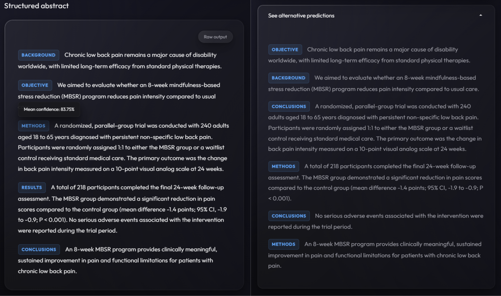  
<br>

### A closer look at the raw output

Behind every prediction there are five raw scores, one per class, showing how much the model leaned towards each label. Here's a sample abstract:

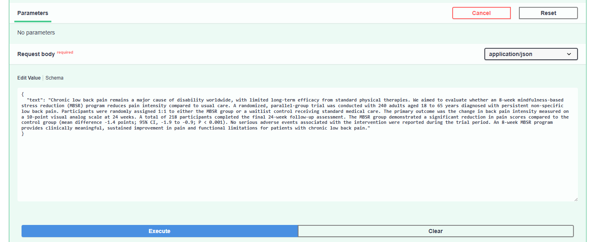
<br>

And here's what the API sends back for it. It's long, so I've folded it away. Open it if you're curious.

<details>
<summary><b>See the full API response for this example</b></summary>

```json
{
  "success": true,
  "data": [
    {
      "text": "Chronic low back pain remains a major cause of disability worldwide, with limited long-term efficacy from standard physical therapies.",
      "predictedClass": "BACKGROUND",
      "confidence": 0.6914839148521423,
      "alternative": {
        "predictedClass": "OBJECTIVE",
        "confidence": 0.11462412029504776
      },
      "rawScores": [
        0.6914839148521423,
        0.10128433257341385,
        0.036723311990499496,
        0.11462412029504776,
        0.055884331464767456
      ]
    },
    {
      "text": "We aimed to evaluate whether an 8-week mindfulness-based stress reduction (MBSR) program reduces pain intensity compared to usual care.",
      "predictedClass": "OBJECTIVE",
      "confidence": 0.6512438058853149,
      "alternative": {
        "predictedClass": "BACKGROUND",
        "confidence": 0.26813048124313354
      },
      "rawScores": [
        0.26813048124313354,
        0.031246602535247803,
        0.02932562679052353,
        0.6512438058853149,
        0.02005341835319996
      ]
    },
    {
      "text": "A randomized, parallel-group trial was conducted with 240 adults aged 18 to 65 years diagnosed with persistent non-specific low back pain.",
      "predictedClass": "METHODS",
      "confidence": 0.8127331137657166,
      "alternative": {
        "predictedClass": "CONCLUSIONS",
        "confidence": 0.0701058879494667
      },
      "rawScores": [
        0.037877969443798065,
        0.0701058879494667,
        0.8127331137657166,
        0.03680719807744026,
        0.042475901544094086
      ]
    },
    {
      "text": "Participants were randomly assigned 1:1 to either the MBSR group or a waitlist control receiving standard medical care.",
      "predictedClass": "METHODS",
      "confidence": 0.8258354663848877,
      "alternative": {
        "predictedClass": "CONCLUSIONS",
        "confidence": 0.0656890720129013
      },
      "rawScores": [
        0.029055284336209297,
        0.0656890720129013,
        0.8258354663848877,
        0.03681573271751404,
        0.0426044762134552
      ]
    },
    {
      "text": "The primary outcome was the change in back pain intensity measured on a 10-point visual analog scale at 24 weeks.",
      "predictedClass": "METHODS",
      "confidence": 0.8740441203117371,
      "alternative": {
        "predictedClass": "CONCLUSIONS",
        "confidence": 0.038470081984996796
      },
      "rawScores": [
        0.0297878235578537,
        0.038470081984996796,
        0.8740441203117371,
        0.037222184240818024,
        0.02047572284936905
      ]
    },
    {
      "text": "A total of 218 participants completed the final 24-week follow-up assessment.",
      "predictedClass": "RESULTS",
      "confidence": 0.6778584122657776,
      "alternative": {
        "predictedClass": "METHODS",
        "confidence": 0.19731244444847107
      },
      "rawScores": [
        0.025561530143022537,
        0.06460944563150406,
        0.19731244444847107,
        0.03465818986296654,
        0.6778584122657776
      ]
    },
    {
      "text": "The MBSR group demonstrated a significant reduction in pain scores compared to the control group (mean difference -1.4 points; 95% CI, -1.9 to -0.9; P < 0.001).",
      "predictedClass": "RESULTS",
      "confidence": 0.8646373748779297,
      "alternative": {
        "predictedClass": "METHODS",
        "confidence": 0.03808224946260452
      },
      "rawScores": [
        0.028153561055660248,
        0.037246301770210266,
        0.03808224946260452,
        0.03188057616353035,
        0.8646373748779297
      ]
    },
    {
      "text": "No serious adverse events associated with the intervention were reported during the trial period.",
      "predictedClass": "RESULTS",
      "confidence": 0.8739274144172668,
      "alternative": {
        "predictedClass": "CONCLUSIONS",
        "confidence": 0.038773857057094574
      },
      "rawScores": [
        0.02140018530189991,
        0.038773857057094574,
        0.03660152852535248,
        0.02929692715406418,
        0.8739274144172668
      ]
    },
    {
      "text": "An 8-week MBSR program provides clinically meaningful, sustained improvement in pain and functional limitations for patients with chronic low back pain.",
      "predictedClass": "CONCLUSIONS",
      "confidence": 0.8548111319541931,
      "alternative": {
        "predictedClass": "METHODS",
        "confidence": 0.04126443713903427
      },
      "rawScores": [
        0.036142196506261826,
        0.8548111319541931,
        0.04126443713903427,
        0.030422033742070198,
        0.037360113114118576
      ]
    }
  ],
  "rawOutput": "[[0.6914839  0.10128433 0.03672331 0.11462412 0.05588433]\n [0.26813048 0.0312466  0.02932563 0.6512438  0.02005342]\n [0.03787797 0.07010589 0.8127331  0.0368072  0.0424759 ]\n [0.02905528 0.06568907 0.82583547 0.03681573 0.04260448]\n [0.02978782 0.03847008 0.8740441  0.03722218 0.02047572]\n [0.02556153 0.06460945 0.19731244 0.03465819 0.6778584 ]\n [0.02815356 0.0372463  0.03808225 0.03188058 0.8646374 ]\n [0.02140019 0.03877386 0.03660153 0.02929693 0.8739274 ]\n [0.0361422  0.85481113 0.04126444 0.03042203 0.03736011]]"
}
```

</details>

You don't need to read every number. These are the fields that matter:

- **`predictedClass` and `confidence`**: the model's top pick for the sentence, and how strongly it favored it.
- **`alternative`**: the runner-up label and its score.
- **`rawScores`**: all five scores, always in this order: `BACKGROUND`, `CONCLUSIONS`, `METHODS`, `OBJECTIVE`, `RESULTS`. They add up to 1.
- **`rawOutput`**: the same scores for every sentence, printed as plain text. I mostly keep it around for debugging.

The same scores appear in the **Raw output** panel of the UI:

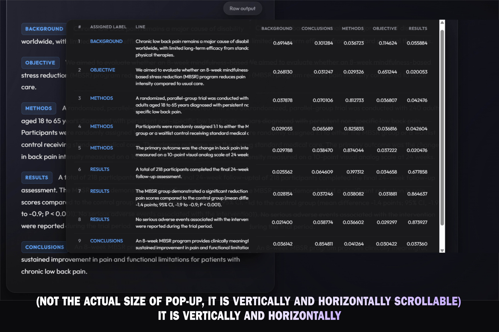  
<br>

---

## What Structura Does

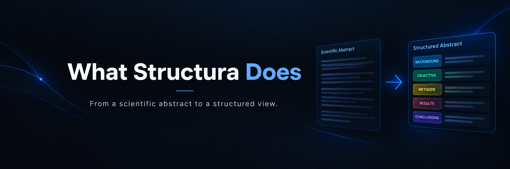

A scientific abstract usually tells a small story. It starts with the problem, says what the study set out to do, explains how it was done, reports what was found, and ends with what it all means.

Structura looks at each sentence on its own. Take this abstract:

```text
Chronic low back pain remains a major cause of disability worldwide, with limited long-term efficacy from standard physical therapies. We aimed to evaluate whether an 8-week mindfulness-based stress reduction (MBSR) program reduces pain intensity compared to usual care. A randomized, parallel-group trial was conducted with 240 adults aged 18 to 65 years diagnosed with persistent non-specific low back pain. Participants were randomly assigned 1:1 to either the MBSR group or a waitlist control receiving standard medical care. The primary outcome was the change in back pain intensity measured on a 10-point visual analog scale at 24 weeks. A total of 218 participants completed the final 24-week follow-up assessment. The MBSR group demonstrated a significant reduction in pain scores compared to the control group (mean difference -1.4 points; 95% CI, -1.9 to -0.9; P < 0.001). No serious adverse events associated with the intervention were reported during the trial period. An 8-week MBSR program provides clinically meaningful, sustained improvement in pain and functional limitations for patients with chronic low back pain.
```

For it, the model gives every sentence one of these labels:

| Sentence role | What it means |
|---|---|
| `BACKGROUND` | Context, motivation, or a problem being addressed |
| `OBJECTIVE` | The aim, question, or purpose of the study |
| `METHODS` | Study design, participants, procedures, or analysis |
| `RESULTS` | Findings, measurements, statistical outcomes, or observations |
| `CONCLUSIONS` | Interpretation, implication, or final claim |

The frontend then groups consecutive sentences with the same label into labeled blocks. Your text itself never changes.

---

## User Workflow

1. Start the Docker Compose stack and open the frontend at `http://localhost:3000`.
2. Paste a scientific abstract into the text area, or pick one of the built-in samples.
3. Select **Analyze abstract**.
4. The frontend sends your text to the Spring Boot API.
5. Spring Boot passes it on to the internal ML service.
6. The ML service splits the abstract into sentences and predicts a label for each one.
7. The frontend shows the main predictions as a structured abstract.
8. Expand the alternative prediction panel to see the second most likely label for each sentence.
9. Open **Raw output** to see the score for every class.

**Clear** removes the input and any results. While the model is working, the input and the analyze button are disabled and a loading state is shown. If the request fails, the frontend logs the error and shows a browser alert.

---

## System Architecture

Here's the path a request takes, from pasting an abstract to seeing the result:

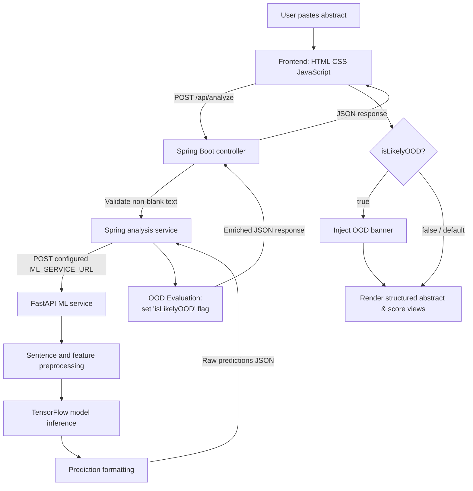

### Why there are two backend services

Structura has two backends: one in Java (Spring Boot) and one in Python (FastAPI). Here's what each one does.

**Spring Boot** is the one the browser talks to. It owns the public `/api/analyze` route, checks the request, and sends the text to the model service using Spring's `RestClient`. When the answer comes back, it also runs the out-of-domain check (more on that later).

**FastAPI** handles everything Python-specific about the model. It loads TensorFlow, Keras Hub, spaCy, the model assets, the vocabulary files, and the trained weights. Keeping all of that in its own service means the Java side never has to load TensorFlow or know how the model is put together.

Inside Docker Compose, the two services talk over the internal network. The backend calls:

```text
http://ml-service:8000/analyze
```

The browser only talks to the Spring backend, never straight to the ML service.

#### "But isn't Spring Boot just passing things along?"

You might be thinking that, and it's a fair question. Right now the Spring layer does three small jobs: it validates the request, forwards it, and adds the OOD flag. FastAPI could do all of that on its own with Pydantic models, so today there's no big technical win from having Spring in the middle. I'd rather be upfront about that.

So why did I do it? Spring Boot is still the backbone of a lot of large company software, in places like banking, insurance, and big e-commerce. Teams there often add ML features as a separate Python service next to their Java system, instead of rewriting everything in Python. I wanted to learn what that kind of setup feels like, and Structura is my practice project for it.

It also keeps my options open:

- **Upgrading the model?** I only touch the ML service.
- **Adding a database, user accounts, or history?** I only touch the Spring Boot code. The ML side doesn't need to know.
- **Moving the frontend to something like React?** The backend and ML service stay as they are, as long as the new frontend calls the same `/api/analyze` route.

Here's the same idea as a picture. The dashed boxes are things I might add later:


That's the idea I'm exploring: every piece can change without the others noticing.

### Request lifecycle

1. The frontend trims the text and sends it as JSON: `{ "text": "..." }`.
2. `AbstractAnalysisController` rejects a missing or blank `text` with HTTP `400`.
3. `AbstractAnalysisService` builds the same request and posts it to `ML_SERVICE_URL`.
4. FastAPI runs the text through `preprocess_text`.
5. For every sentence, the model gets three kinds of information: what it means, which characters it contains, and where it sits in the abstract.
6. The ML service turns the probabilities into a main prediction and an alternative prediction.
7. Spring Boot receives the result and runs the out-of-domain check.
8. The combined result goes back to the frontend as JSON.
9. JavaScript groups neighboring predictions and builds the result view, with a warning banner if the text was flagged as OOD.

---

## Frontend


The frontend lives in [frontend/index.html](frontend/index.html), [frontend/script.js](frontend/script.js), and [frontend/styles.css](frontend/styles.css). I kept it deliberately simple: no framework, no package manager, no bundler, and no build step. You can read all of it in three files.

### What the page does

- A text area for your abstract
- An analyze button that stays disabled until you type something
- A clear button
- A loading indicator while the request is running
- A few prewritten sample abstracts, including one out-of-domain example
- A structured result panel
- An alternative predictions panel
- A raw score table
- A light/dark theme toggle
- A short section on the model's limitations

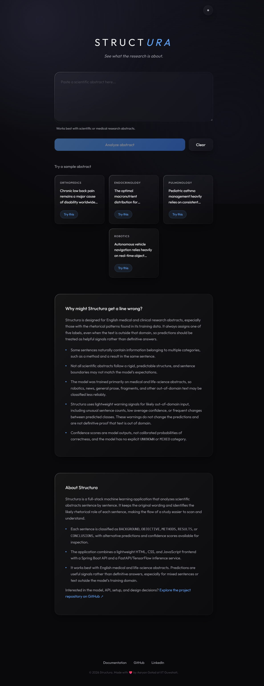  
<br>

### How predictions are shown

The API returns one result per sentence. The frontend goes through them in order and starts a new block whenever the predicted label changes. It never reorders sentences, and it never asks the model to write a new abstract.

Each block shows:

- The predicted label
- The original sentences
- The average confidence across the sentences in that block

The alternative predictions panel works the same way, but uses `alternative.predictedClass` and `alternative.confidence` instead.

The raw score table shows the five scores in this order:

```text
BACKGROUND, CONCLUSIONS, METHODS, OBJECTIVE, RESULTS
```

The model service returns confidence as a fraction between `0` and `1`. The frontend shows it as a percentage, and the raw score table shows values to six decimal places.

  
<br>

### Which API URL it uses

When the page runs on `localhost` or `127.0.0.1`, JavaScript sends requests to:

```text
http://localhost:8080
```

On GitHub Codespaces-style hostnames (ending in `.app.github.dev`), the script swaps the forwarded port in the hostname for `8080`. On any other host, it uses the current protocol and a derived backend hostname. This is handy in development setups where the frontend and backend ports are forwarded separately.

### Remembering your theme

Your theme choice is saved in the browser's local storage under this key:

```text
structura-theme
```

Anything other than `light` falls back to the dark theme the next time the page loads.

---

## Spring Boot Backend

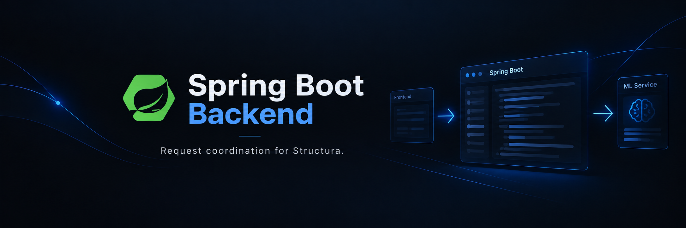

The backend is a Spring Boot application running on Java 21. Its job is to coordinate requests, not to run the model.

### What it's built with

- Java 21
- Spring Boot `4.1.1`
- Spring MVC
- Spring `RestClient`
- Jackson for JSON
- Maven Wrapper
- Virtual threads, turned on through application configuration

### Configuration

The backend listens on all interfaces on port `8080`:

```properties
server.port=8080
server.address=0.0.0.0
```

The ML service URL can be set with the `ML_SERVICE_URL` environment variable:

```properties
structura.ml-service-url=${ML_SERVICE_URL:http://localhost:8000/analyze}
```

The default works when the ML service runs directly on your machine. Docker Compose overrides it with the internal service name.

### CORS

The backend accepts cross-origin requests for `/api/**` from any origin, and allows `GET`, `POST`, `PUT`, `DELETE`, and `OPTIONS`. That's convenient for local development and for frontends hosted elsewhere, but a production deployment should narrow the allowed origins once the public frontend URL is known.

---

## Deep Learning Model

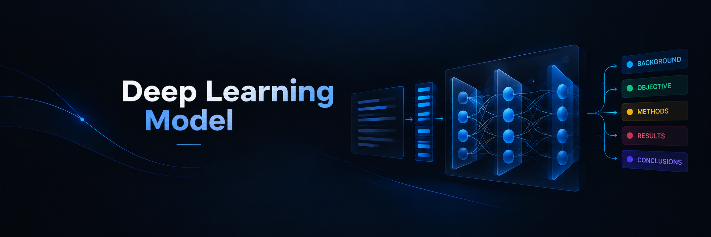

All models were built with TensorFlow/Keras. 

Structura's model is a five-class sentence classifier. For each sentence it looks at three things at once: what the sentence says, how it's written (down to the characters), and where it sits in the abstract. It then combines them into one prediction.

This section covers the dataset, the model itself, the experiments that led to it, and how well it does. I've kept the experiments in because they explain why the final model looks the way it does, and I explain the unfamiliar terms along the way.

### Dataset

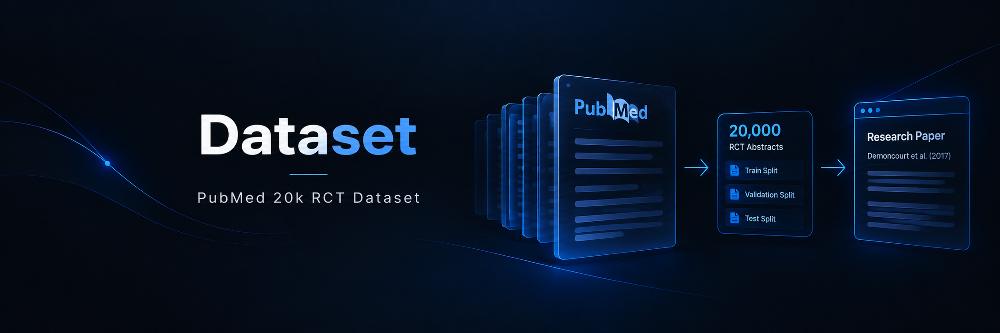

The dataset, and my training goals, come from this [**research paper**](https://arxiv.org/abs/1710.06071).

I trained on the PubMed 20k RCT dataset from the official [pubmed-rct repository](https://github.com/Franck-Dernoncourt/pubmed-rct). Every experiment used the prepared PubMed 20k split, where numbers are replaced by `@`, along with its provided training, validation, and test partitions. Each sentence is labeled with its role in the abstract:

- `BACKGROUND`
- `OBJECTIVE`
- `METHODS`
- `RESULTS`
- `CONCLUSIONS`

The partitions contain **180,040** training sentences, **30,212** validation sentences, and **30,135** test sentences. In the training set, the classes were spread like this:

| Class | Training sentences |
|---|---:|
| `METHODS` | 59,353 |
| `RESULTS` | 57,953 |
| `CONCLUSIONS` | 27,168 |
| `BACKGROUND` | 21,727 |
| `OBJECTIVE` | 13,839 |

`OBJECTIVE` has the fewest examples, and the model often mixed it up with `BACKGROUND`.

### What the model does

The model reads an abstract as a collection of sentences and gives each sentence a set of five probabilities, one per label.

The five labels are loaded from [ml_service/utilities/class_names.txt](ml_service/utilities/class_names.txt):

```text
BACKGROUND
CONCLUSIONS
METHODS
OBJECTIVE
RESULTS
```

The order in this file matters. The model's outputs are turned into labels using this same order, so changing it would mix up the labels.

### The final architecture


My final architecture is inspired by this paper:
> [Neural Networks for Joint Sentence Classification in Medical Paper Abstracts by Dernoncourt, 2017](https://arxiv.org/abs/1612.05251)

The inference service doesn't load the saved model directly. Instead, `load_structura_model()` rebuilds it: it pulls the vocabulary files and the weights out of `model/structura.keras`, recreates the layers, and then loads the trained weights back in. I did it this way to save memory. Rebuilding from the weights let me skip the optimizer weights entirely.

The model has four input branches, and each one looks at a sentence in a different way:


#### 1. Semantic branch: what the sentence means

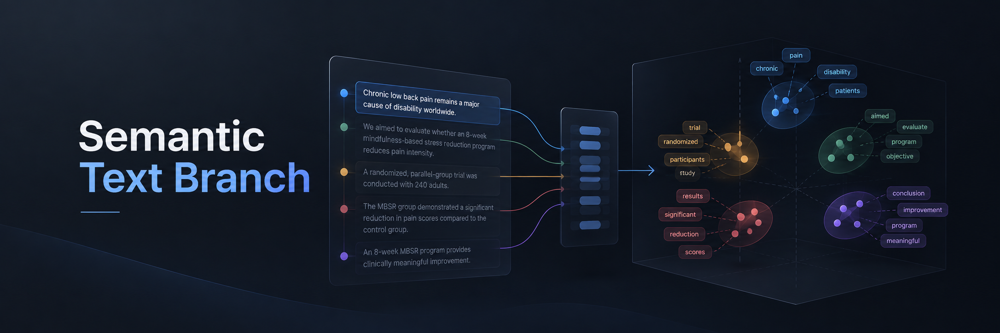

This branch uses the `all_minilm_l6_v2_en` model from Keras Hub (a small BERT-style model called MiniLM), through a `BertTextEmbedder`. Here's how it's set up:

- BERT tokenizer vocabulary, extracted from the Keras archive
- Lowercase tokenization
- Accent stripping
- Word-piece suffix indicator `##`
- `[UNK]` token for unknown words
- Maximum sequence length of `256`
- Round-robin truncation
- Mean pooling
- Normalized embeddings
- Embedder weights frozen during inference
- A dense layer of `128` units with ReLU activation on top

This branch gives the model a sense of what each sentence means, including how words and phrases relate to each other. That's hard to get from individual characters alone.

#### 2. Character branch: how the sentence is written


This branch reads a version of each sentence with its characters spaced out:

```text
The study worked.
```

becomes, roughly:

```text
T h e   s t u d y   w o r k e d .
```

It has:

- A `TextVectorization` layer using the extracted character vocabulary
- An embedding layer with output size `25`
- A bidirectional LSTM with `32` units in each direction

Looking at characters helps with spelling, punctuation, abbreviations, and the shapes of domain-specific words.

#### 3. Sentence-position branch: where the sentence sits

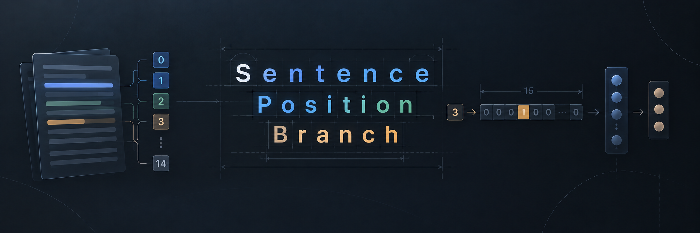

Each sentence gets a zero-based position in the abstract. That position is one-hot encoded with depth `15` and passed through a dense layer of `32` ReLU units.

This tells the model where a sentence appears, which is useful because abstracts tend to follow a fairly regular order.

#### 4. Total-sentence-count branch: how long the abstract is


The total number of sentences is one-hot encoded with depth `20` and passed through another dense layer of `32` ReLU units.

This gives the model a feel for how long the abstract is, and so what kind of surroundings each sentence is in.

It also means that abstracts with more than 20 sentences get truncated down to 20, and Structura flags them as OOD (Out Of Domain).

### Putting it together: the classification head

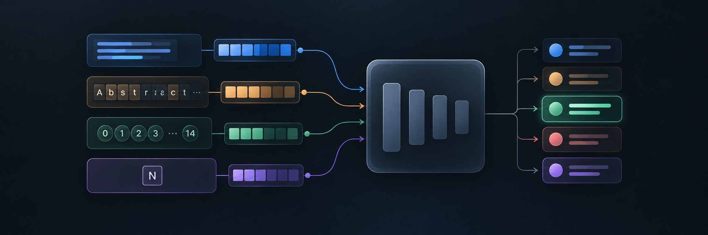

The meaning and character representations are joined first. The combined result then goes through:

- A dense layer with `256` ReLU units
- Dropout with rate `0.5`
- Concatenation with the two position representations
- A final dense layer with `5` units and softmax activation

The softmax output is a set of five probabilities for one sentence. The highest becomes the main prediction, and the second-highest becomes the alternative prediction.

### How the model is loaded

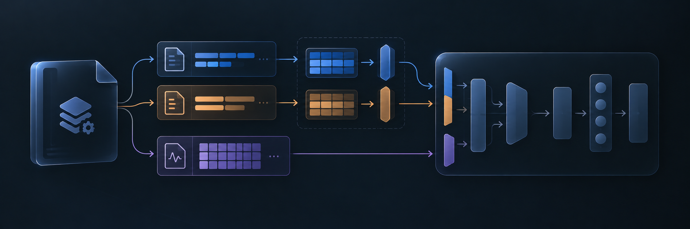

When the ML service starts, it expects to find:

```text
ml_service/model/structura.keras
```

That file is really a ZIP archive. The service pulls three things out of it:

```text
assets/layers/bert_text_embedder_preprocessor/tokenizer/vocabulary.txt
assets/layers/text_vectorization/vocabulary.txt
model.weights.h5
```

They're written to `ml_service/model_extract/`. The model is loaded once, when the FastAPI process starts. If loading fails, the process prints the error and exits, rather than running a server that can't make predictions.

---

### How I ran the experiments

I ran the early architecture experiments on 10% of the training data, so each try was quick. Treat those numbers as a way of choosing an architecture, not as full-data benchmarks. Validation used the complete validation split where the notebook says so. The early models were written in Keras 2, and I later rebuilt the production model for Keras 3 and low-memory inference.

In the token model experiment, I used batches of 32 with TensorFlow datasets and prefetching.

---

### Architecture experiments

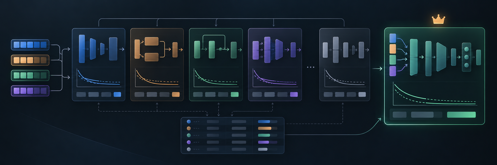

| Experiment | Main architecture | Validation accuracy | Validation F1 |
|---|---|---:|---:|
| Baseline | TF-IDF plus Multinomial Naive Bayes | 72.18% | 69.89% |
| Token model | TextVectorization, token embedding, Conv1D, global average pooling | 78.71% | 78.47% |
| Pretrained feature extractor | Universal Sentence Encoder plus dense classifier | 71.52% | 71.23% |
| Character model | Character embedding, Conv1D, global max pooling | 64.82% | 63.67% |
| Hybrid model | Universal Sentence Encoder plus character BiLSTM | 73.48% | 73.11% |
| Tribrid model | Token and character features plus sentence-position features | 83.28% | 83.20% |

The best of these was the tribrid model. It combined token meaning, character patterns, the sentence's position, and the abstract's total sentence count. On the held-out test set it reached 82.57% accuracy, 82.43% precision, 82.57% recall, and 82.47% F1. That was encouraging enough that I redesigned it around MiniLM for deployment.

---

### Moving to MiniLM

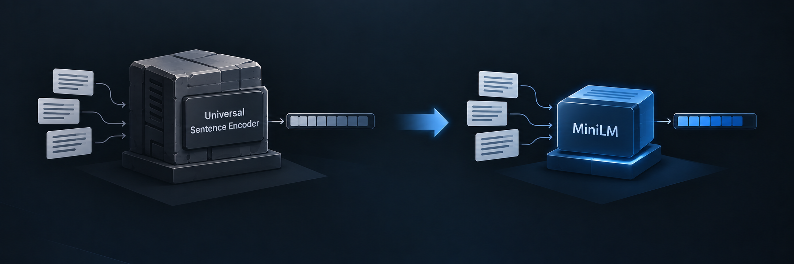

For the deployed model I switched to MiniLM (`all_minilm_l6_v2_en` from Keras Hub). It gave stronger sentence representations in a much smaller package: about 80 MB, compared with close to 1 GB for the Universal Sentence Encoder version.

| Experiment | Change | Result |
|---|---|---:|
| MiniLM 1 | Frozen MiniLM with character BiLSTM and positional branches; 10% training data | 83.62% validation accuracy, 0.9314 loss |
| MiniLM 2 | Same architecture trained on the full training split for five epochs | 86.47% validation accuracy, 0.8849 loss |
| MiniLM 3 | Added early stopping and learning-rate reduction | 86.40% validation accuracy, 0.8933 loss |
| MiniLM 4 | Fine-tuned the MiniLM backbone | 89.45% validation accuracy, 0.8415 loss |
| MiniLM 5 | Replaced the character BiLSTM with Conv1D | 89.15% validation accuracy after fine-tuning |
| MiniLM 6 | Final full-data model with MiniLM and character BiLSTM | 89.04% test accuracy |

In MiniLM 5 I tried swapping the character BiLSTM for Conv1D, as an ablation (removing or swapping one part to see what changes). I kept the BiLSTM in the final model because it did better in my results.

---

### Final training configuration

Here are the settings I used to train the final model. A few of these terms might be new, so I explain each one right after the list.

- **Loss:** categorical cross-entropy, with label smoothing of `0.2`
- **Optimizer:** Adam, with a learning rate of `1e-3` for fine-tuning and gradient clipping (`clipnorm=1.0`)
- **Dropout:** rate `0.5`, in the classification head
- **Early stopping (`EarlyStopping`):** watches `val_accuracy`, with patience `3` and `restore_best_weights=True`
- **Learning-rate reduction (`ReduceLROnPlateau`):** watches `val_loss`, with factor `0.5`, patience `2`, and a minimum learning rate of `1e-6`

#### Label smoothing

*In one line: it stops the model from being overconfident.*

The model ends by producing five probabilities, one per label. Normally, we train it towards the "perfect" answer. If a sentence is `BACKGROUND`, the target is `[1, 0, 0, 0, 0]`: 100% sure of one label and 0% for the rest. To get close to that, the model has to push its internal numbers to extreme values, and that makes it overconfident.

Label smoothing softens the target a little. Instead of aiming for exactly `[1, 0, 0, 0, 0]`, the model aims for something slightly less extreme. If you set the smoothing value `α` (a number between 0 and 1), Keras changes the true target like this:

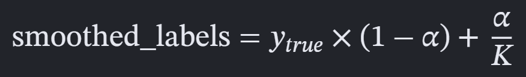  
<br>

*(where K is the total number of classes)*

Here's a worked example with my values:

* `y_true` = `[1, 0, 0, 0, 0]` (`BACKGROUND`)
* `α` = `0.2`
* K = 5

For the true class: 1 × (1 − 0.2) + 0.2 / 5 = 0.84. For each of the other classes: 0 × (1 − 0.2) + 0.2 / 5 = 0.04. So the target becomes `[0.84, 0.04, 0.04, 0.04, 0.04]` instead of `[1.0, 0.0, 0.0, 0.0, 0.0]`.

A smoothing value of `0.1` is the usual choice. I went with `0.2` because neighboring sentences in medical abstracts are often hard to tell apart, especially `BACKGROUND` and `OBJECTIVE` at the point where one section turns into the next. I didn't want the model to be too sure of itself there. I was hoping for two benefits:

1. **Less overfitting.** It should stop the MiniLM backbone from memorizing very regular inputs and inflating its output numbers.
2. **A better balance.** It should stop the model from leaning too hard on the position features, so it keeps using what a sentence says as well as where it sits.

As a sanity check, the final accuracy (`89.04%`) and F1 score (`88.92%`) ended up very close to each other. That suggests the model wasn't doing well on some classes while ignoring others.

#### Gradient clipping (`clipnorm`)

While training, the model learns by nudging its weights using *gradients*: numbers that say which way to adjust each weight, and by how much. Sometimes a gradient gets huge, and one huge nudge can throw training off completely. The loss can even turn into `NaN` (Not a Number). This is called the **exploding gradient problem**, and models that work with text can be prone to it. Errors get multiplied over and over as they travel back through many steps or layers, so a slightly-too-large weight can snowball.

Setting `clipnorm=1.0` works like a speed limit. For each weight matrix, Keras measures the length (the L2 norm) of its gradient. If that length is over 1.0, Keras shrinks the whole gradient until its length is exactly 1.0. If it's already 1.0 or less, nothing changes. Even if one batch of text causes a big spike, the model only takes a small, safe step.

Here's the rule:

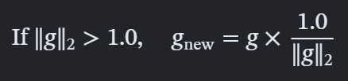  
<br>

* If the norm is 0.75: nothing changes. The gradients are used exactly as calculated.
* If the norm is 5.0: every value in the gradient is divided by 5.0.

Because the whole gradient shrinks by the same ratio, it still points in the same direction. Only its length gets shorter.

#### Dropout

Dropout randomly switches off a share of the units in a layer on each training step. With a rate of `0.5`, that's half of them. The model can't lean on any single unit, which helps it generalize to sentences it hasn't seen.

#### Early stopping

If validation accuracy hasn't improved for `3` epochs in a row, training stops, and the model goes back to the best weights it had seen. That saves time and avoids overtraining.

#### Learning-rate reduction

If validation loss hasn't improved for `2` epochs, the learning rate is cut in half (down to a floor of `1e-6`). Smaller steps help the model settle in once it's close to a good solution.

---

### Final test results

I evaluated the final model on the test split, which I didn't use while choosing the model:

| Metric | Final test result |
|---|---:|
| Accuracy | 89.04% |
| Precision | 88.91% |
| Recall | 89.04% |
| F1 score | 88.92% |

---

### Confusion matrix

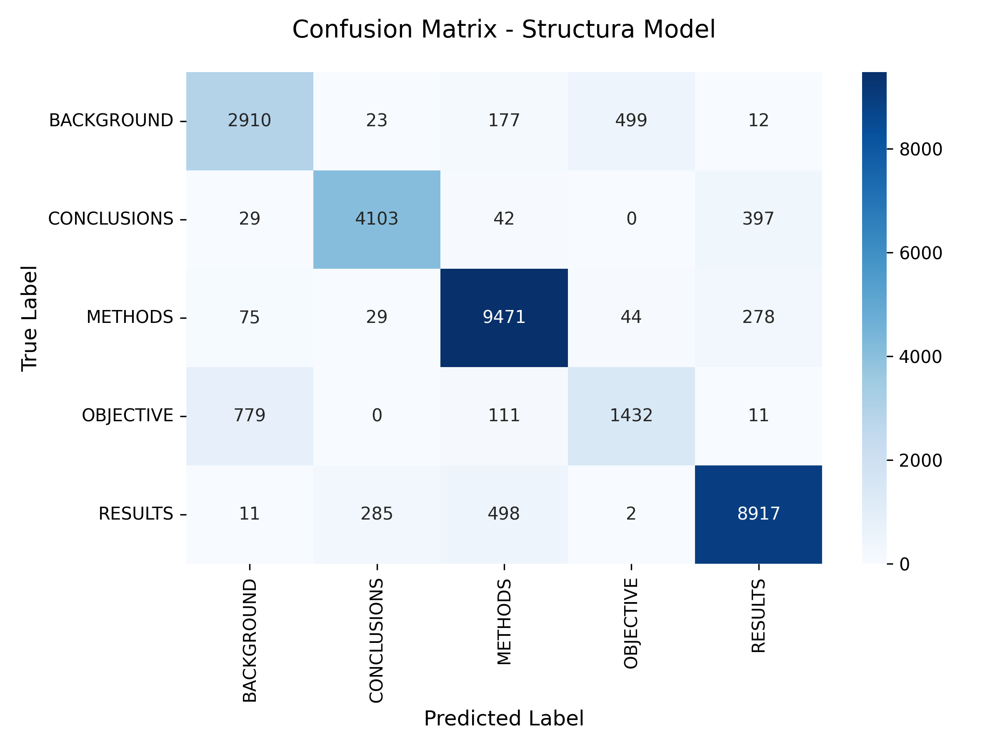

A confusion matrix shows, class by class, where the model got things right and where it got mixed up. Rows are the true labels and columns are what the model predicted. The big numbers down the diagonal are good news: the model learned the overall structure of abstracts well, especially for `METHODS`, `RESULTS`, and `CONCLUSIONS`.

- **BACKGROUND:** 2,910 sentences were classified correctly. The most common mix-up was `OBJECTIVE` (499 sentences), then `METHODS` (177). That makes sense, since background and objective sentences often sit next to each other at the start of an abstract and can read alike.
- **CONCLUSIONS:** 4,103 correct. The most frequent mistake was predicting `RESULTS` (397 sentences). Reporting the final findings and interpreting them can sound very similar at the end of an abstract.
- **METHODS:** The strongest class, with 9,471 correct predictions. Only a few were confused with `RESULTS` (278), `BACKGROUND` (75), or `OBJECTIVE` (44). The language of procedures seems distinctive enough for the model to recognize.
- **OBJECTIVE:** The hardest class. Of 2,333 true objective sentences, 1,432 were classified correctly and 779 were predicted as `BACKGROUND`. Objective statements usually come right after the background and can share a lot of its wording and context.
- **RESULTS:** 8,917 correct. The most common mistakes were `METHODS` (498) and `CONCLUSIONS` (285). Sentences describing procedures or summarizing findings can overlap in vocabulary and structure.

Overall, most mistakes happen between neighboring or related sections, not between unrelated ones. The matrix matches the final test accuracy of `89.04%` and F1 score of `88.92%`. The thing I'd most like to improve is telling `OBJECTIVE` apart from `BACKGROUND`. `METHODS` and `RESULTS` are handled well.

---

### Out-of-domain detection

Out-of-domain (OOD) just means "not the kind of text the model was trained on." Structura is built for English medical and clinical research abstracts, especially ones that read like the PubMed 20k RCT abstracts. A robotics abstract, a news article, a very short fragment, or a long block of unrelated prose can still be run through the model, but the results won't be as trustworthy.

There's a catch: the model has no `UNKNOWN` label. It always has to spread its probability across `BACKGROUND`, `OBJECTIVE`, `METHODS`, `RESULTS`, and `CONCLUSIONS`, so it can't say "this doesn't look like an abstract." That means OOD text can still come back with confident-looking labels. Those labels aren't proof that the text is a medical paper, or that its structure was read properly.

So I added a lightweight check after the model has answered. It isn't another neural network, and it never changes your labels. It's a few simple rules in the Spring Boot backend, where all the sentence results are available together. The result goes into the `isLikelyOOD` field, and the frontend uses it to show a warning above the analysis, which is still displayed.

#### How the check works

The logic lives in `backend/src/main/java/com/aaryan/structura/OodClassifier.java`. It looks at the list of `SentPredDTO` objects returned by the ML service (each has the sentence, the main `predictedClass`, and its `confidence`). It returns `true` as soon as any of these three things looks off:

1. **Sentence count.** The list must contain at least `3` and at most `20` sentences, and both limits are inclusive. Fewer than three sentences gives too little structure to analyze. More than thirty is beyond a normal abstract and may not fit the model's fixed position features.

2. **Mean confidence.** The classifier averages the main confidence of every sentence:

   ```text
   mean confidence = (confidence_1 + confidence_2 + ... + confidence_N) / N
   ```

   If the mean is below `0.45`, the text is flagged. A mean of exactly `0.45` passes, because the check is a strict `< 0.45`. This uses only the confidence of each sentence's winning label, not the alternative score and not the average of `rawScores`. A low average means the model keeps being unsure about which label fits.

3. **Label changes.** The classifier compares each sentence's label with the one before it, counts the changes, and divides by the number of neighboring pairs:

   ```text
   change rate = number of adjacent class changes / (N - 1)
   ```

   If the rate is `0.67` or higher, the text is flagged. A real abstract tends to move through its sections in order, so labels that keep jumping around suggest the model is guessing. A steady sequence can still be wrong, so this is a hint rather than proof.

The checks are combined with OR, not voting. Failing any one of them is enough to flag the text. A `null` list counts as OOD, because there's nothing to evaluate. An empty list is caught by the sentence-count rule. With a single sentence there are no neighboring pairs, so the label-change check is skipped, but the sentence-count rule still flags it.

#### Where the flag gets added

`AbstractAnalysisService` calls the ML service first and keeps its sentence predictions and raw output. Then it calls `oodClassifier.isLikelyOOD(response.data())` and builds the `AnalyzeResponseDTO` that goes to the browser, with the flag included. That way, the ML service only worries about preprocessing and inference, and the Spring Boot layer decides how to interpret the results.

When `isLikelyOOD` is `true`, the frontend keeps every prediction as it is and shows a message saying the text looks different from the medical abstracts Structura usually reads, so the labels may be less accurate. I did this on purpose. It's a heads-up about reliability, not a verdict, and not a rejection of your input.

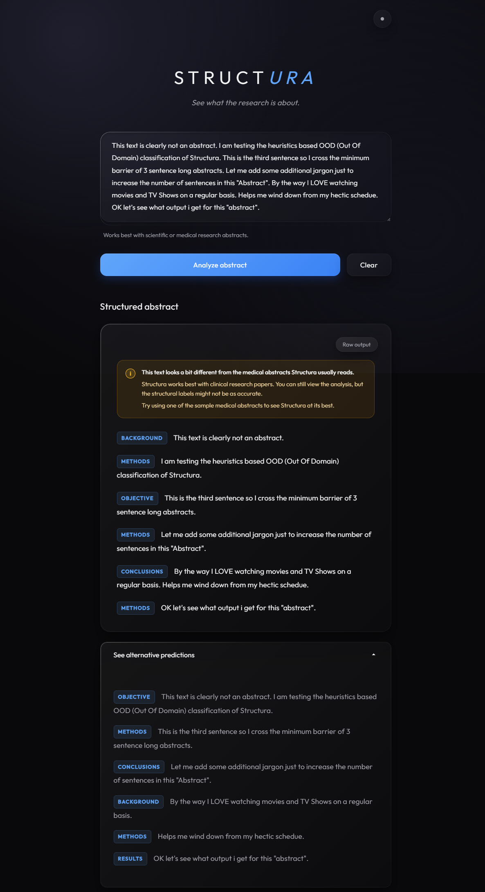  
<br>

Please treat these checks as hints. An unusual but genuine abstract might get flagged, and a non-medical text written in the style of a clinical abstract might slip through. The thresholds (`0.45`, `0.67`, `3`, and `30`) are my own rules of thumb. If the detector ever matters for something important, they should be tuned against a labeled mix of in-domain and OOD abstracts.

---

### Deployment considerations

My first version of the model was a Keras 2 SavedModel of about 990 MB, and it could use several gigabytes of memory while loading. That was far too heavy for the low-memory environment I was aiming for, including the live Streamlit Community Cloud deployment.

The MiniLM redesign brought the model assets down to about 80 MB before the final archive. It also let me rebuild the model in Keras 3 from the stored vocabularies and the `model.weights.h5` weights.

At startup, the loader:

1. Extracts the tokenizer vocabulary, the character vocabulary, and the weights from the `.keras` archive
2. Rebuilds the architecture
3. Freezes the MiniLM embedder for inference
4. Restores the trained weights

Inference runs on the CPU.

One thing to keep in mind: the loader currently passes `skip_mismatch=True` to `load_weights`. That stops startup from failing when some weights don't match, but it can also hide the fact that some weights weren't restored. If you change the architecture, check that all the weights actually load.

### Known limitations


Structura isn't perfect, and I'd rather you know where it struggles:

- The position features have fixed sizes: `15` for a sentence's position and `20` for the total sentence count. Very long abstracts can go past these and get truncated.
- The model most often mixes up `OBJECTIVE` and `BACKGROUND`, partly because of the training imbalance.
- I haven't systematically tested non-scientific text, out-of-domain abstracts, or sentences that do more than one job.
- It always picks one of five labels. There's no `UNKNOWN` or `MIXED` label.
- A sentence can have more than one role, but the output only has one main and one alternative label.
- Sentence splitting relies on spaCy's sentencizer, which may not match the formatting of every abstract.
- The confidence numbers aren't calibrated. A score of 90% doesn't mean the model is right 90% of the time.
- The backend doesn't have a custom error response for when the ML service fails.
- CORS is wide open for development and should be restricted for a public deployment.

---

## Inference Preprocessing

The preprocessing pipeline lives in [ml_service/utilities/utils.py](ml_service/utilities/utils.py).

### Sentence splitting


The service creates a lightweight English spaCy pipeline and adds spaCy's `sentencizer`. The sentences it finds become the units the model predicts on.

I deliberately didn't split on newlines or with a regular expression. The sentencizer decides where sentences end, so punctuation and spacing in your text affect how it gets split.

### Positional features

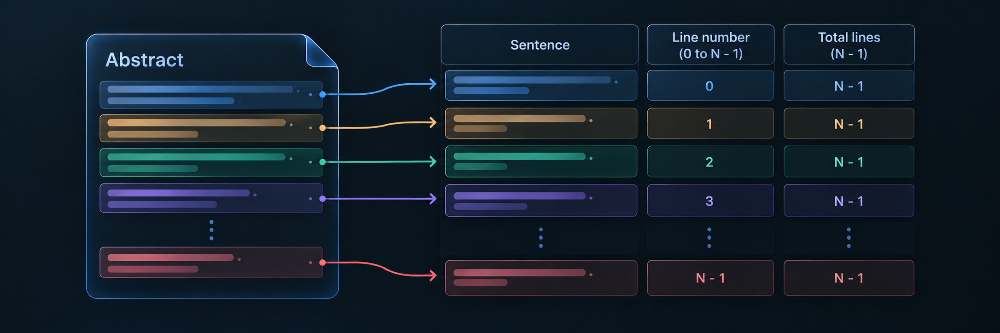

For an abstract with `N` sentences, each sentence gets:

- A zero-based line number, from `0` to `N - 1`
- A total-line value of `N - 1`

Line numbers are one-hot encoded with depth `15`, and total-line values with depth `20`.

These fixed sizes are part of how the model was designed. Very long abstracts can fall outside them, so test them before relying on the results.

### Character features

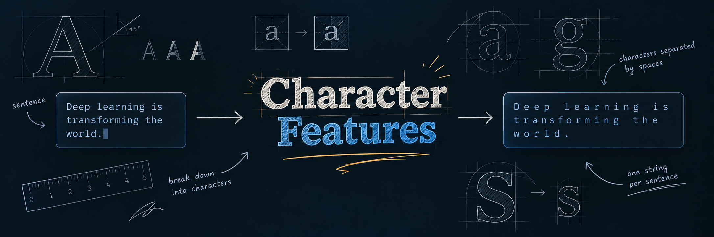

Each sentence is turned into a string with its characters separated by spaces. That string then goes through the stored vocabulary and embedding layers.

### Prediction formatting

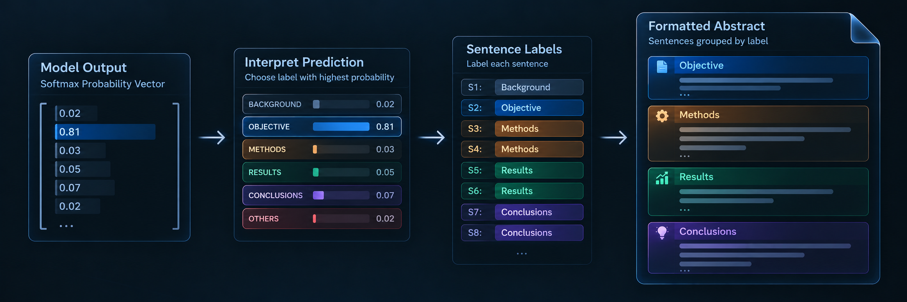

For each sentence, the ML service:

1. Runs the model and gets five probabilities.
2. Picks the highest one as `predictedClass`.
3. Picks the second-highest as `alternative.predictedClass`.
4. Returns those probabilities as the `confidence` values.
5. Returns all five as `rawScores`.

Confidence values in the JSON are decimals like `0.9234`, not whole-number percentages. The frontend multiplies them by `100` when it shows the average confidence in a tooltip.

---

## API Reference

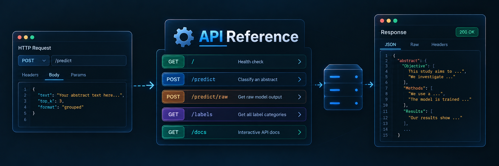

### Public endpoint: `POST /api/analyze`

This is the endpoint the browser uses. Spring Boot serves it on port `8080`.

#### Request

```http
POST /api/analyze
Content-Type: application/json
```

```json
{
  "text": "Heart failure is a growing public health concern. This study evaluated a new treatment."
}
```

#### Example with curl

```bash
curl -X POST http://localhost:8080/api/analyze \
  -H "Content-Type: application/json" \
  -d '{"text":"Heart failure is a growing public health concern. This study evaluated a new treatment."}'
```

#### Response

The response comes from the ML service, plus one extra field (`isLikelyOOD`) that Spring Boot adds. It looks like this:

```json
{
  "success": true,
  "data": [
    {
      "text": "Heart failure is a growing public health concern.",
      "predictedClass": "BACKGROUND",
      "confidence": 0.91,
      "alternative": {
        "predictedClass": "OBJECTIVE",
        "confidence": 0.06
      },
      "rawScores": [0.91, 0.01, 0.01, 0.06, 0.01]
    }
  ],
  "rawOutput": "[[...]]",
  "isLikelyOOD": false
}
```

`rawOutput` is currently the model's probability array printed as a string. I keep it so you can inspect it, while `data` holds the structured objects the frontend uses.

`isLikelyOOD` is `true` when any of these backend checks suggests the input is outside what the model supports:

- The mean confidence of the main predictions is below `0.45`.
- The rate of label changes between neighboring sentences is at least `0.67`.
- The number of sentences is fewer than `3` or more than `30`.

The sentence count comes from the same sentence-level results the FastAPI service produced. The frontend uses this flag to pick the right message to show.

#### Request validation

The Spring controller returns HTTP `400 Bad Request` when:

- The request body is missing
- The `text` property is missing
- The `text` property is blank

I haven't set a maximum character count. The model's fixed position features still limit how long an abstract can usefully be.

### Internal endpoint: `POST /analyze`

The FastAPI service exposes the model endpoint directly on port `8000`.

```bash
curl -X POST http://localhost:8000/analyze \
  -H "Content-Type: application/json" \
  -d '{"text":"This study evaluated a new treatment."}'
```

It takes the same request and returns the same response shape. In a real deployment, this service should stay private and only receive traffic from the Spring backend over the internal network.

### ML health endpoint: `GET /`

```bash
curl http://localhost:8000/
```

Expected response:

```json
{
  "message": "Welcome to the Text Analysis API!"
}
```

Docker Compose uses this endpoint to check that the ML service is healthy.

---

## Docker Compose Deployment

The easiest way to run everything is [docker-compose.yml](docker-compose.yml), which starts all three services.

| Service | Container port | Host port | What it does |
|---|---:|---:|---|
| `frontend` | `80` | `3000` | Serves the browser UI through Nginx |
| `backend` | `8080` | `8080` | Public JSON API, and forwards requests to the ML service |
| `ml-service` | `8000` | `8000` | FastAPI inference service |

### Start the application

From the repository root:

```bash
docker compose up --build
```

Then open:

```text
http://localhost:3000
```

The first build can take a while. The ML image has to install TensorFlow and Keras Hub, and the model loads when the FastAPI process starts. So don't worry if the first run feels slow.

### Startup order

The backend waits for the ML service to be healthy, and the frontend waits for the backend. So the order is:

```text
ml-service -> backend -> frontend
```

Docker Compose gives the backend this environment variable:

```text
ML_SERVICE_URL=http://ml-service:8000/analyze
```

### Useful Docker commands

```bash
# Start in the background
docker compose up --build -d

# Follow logs for every service
docker compose logs -f

# Follow only ML service logs
docker compose logs -f ml-service

# Check service status
docker compose ps

# Stop and remove the Compose containers
docker compose down

# Rebuild images after changing source or model assets
docker compose build --no-cache
```

### What's inside the containers

The backend uses a multi-stage Java image. Maven builds the app with Eclipse Temurin JDK 21, and the final image contains only the JRE and the packaged JAR.

The ML service uses a Python 3.11 virtual environment created in a builder stage. The final image gets that environment and the whole `ml_service` directory, including the model archive, extracted assets, utility module, and class names.

The frontend copies its three static files into an Nginx Alpine image. Nginx falls back to `index.html` for unknown paths, so the single-page interface loads correctly.

### Deployment checklist


I haven't deployed the full stack anywhere yet (that's what the Streamlit demo is for), so some of these are still blanks for me. Think of this as a checklist I'm working through, and one you can use if you take Structura online yourself.

**Things I still need to decide:**

- [ ] **Hosting platform:** where will all three services run?
- [ ] **Public frontend URL:** what address will people visit?
- [ ] **Backend URL or reverse proxy route:** how will the frontend reach the Spring Boot API?
- [ ] **CPU and memory:** how much does the ML service need to run comfortably?
- [ ] **Model startup time:** how long does the model take to load on that hardware?

**Things to double-check before going public:**

- [ ] **Keep port `8000` private.** Only the Spring backend should be able to reach the ML service.
- [ ] **Narrow CORS.** Replace the wildcard with your production frontend's origin.
- [ ] **Give the health check enough time.** Loading the model takes a while, and the platform shouldn't give up on the ML service too early.
- [ ] **Ship the model.** Make sure `model/structura.keras` is included in the deployed image.

---

## Local Development Without Docker

Docker Compose is the easiest way to run everything, but you can also run each service by hand, which is handy for debugging.

### Start the ML service

```bash
cd ml_service
python3 -m venv .venv
source .venv/bin/activate
pip install -r requirements.txt
uvicorn main:app --host 0.0.0.0 --port 8000
```

The model archive needs to be at `ml_service/model/structura.keras` before you start.

### Start the backend

In a second terminal:

```bash
cd backend
./mvnw spring-boot:run
```

By default, the backend forwards to `http://localhost:8000/analyze`. To point it somewhere else:

```bash
ML_SERVICE_URL=http://localhost:8000/analyze ./mvnw spring-boot:run
```

### Serve the frontend

In a third terminal, once the backend is up:

```bash
cd frontend
python3 -m http.server 3000
```

On localhost, the frontend sends requests to `http://localhost:8080`.

This simple server is fine for development. The production-like option is the Nginx container defined in [frontend/Dockerfile](frontend/Dockerfile).

---

## Testing

The backend has a Spring Boot context smoke test (`StructuraApplicationTests`) and tests for the OOD classifier (`OodClassifierTest`). To run them:

```bash
cd backend
./mvnw test
```

---

## Troubleshooting

### The frontend loads but analysis fails

Check that the backend is running on port `8080` and that the browser is using the API URL you expect. Then look at the backend logs:

```bash
docker compose logs -f backend
```

### The backend can't reach the ML service

Inside Docker Compose, `ML_SERVICE_URL` has to use the service name:

```text
http://ml-service:8000/analyze
```

`localhost` inside the backend container means the backend container itself, not the ML container.

### The ML service exits during startup

Look at its logs:

```bash
docker compose logs ml-service
```

The usual suspects are a missing `model/structura.keras`, incompatible model assets, not enough memory, or a failed dependency install.

### Compose keeps waiting for the backend

The backend health check depends on port `8080` accepting connections. Check the backend logs and confirm the Java app started. If your runtime environment doesn't have a shell feature the health check needs, you may have to adapt the health check.

### Blank input returns an error

That's expected. The Spring controller rejects missing or whitespace-only text with HTTP `400`.

### Predictions look unreliable for long abstracts

The model uses fixed one-hot sizes of `15` for sentence positions and `20` for total-line values. Test long inputs against those limits before relying on them.

### CORS errors appear in the browser

The backend currently allows all origins for `/api/**`, so a CORS error usually means the request is going to the wrong host or port, or that a reverse proxy is changing the response headers. Check the frontend's derived API URL and look at the request in your browser's network tab.

---

## Design Decisions

### Sentence-level rather than document-level

Labeling each sentence keeps the original wording and makes the result easy to inspect. You can see exactly which sentence led to each label, instead of getting only a summary of the whole document.

### A mix of ways to read a sentence

The model combines a pretrained model that understands meaning, a character-level view, and position signals. The first captures what the language means, the second captures local details like spelling and punctuation, and the third gives it a sense of the abstract's overall structure.

### Separate Java and Python services

Spring Boot gives the browser API a conventional home, while FastAPI keeps TensorFlow right next to the model code. Docker Compose makes the connection between them explicit and repeatable.

### Keeping the raw scores

The API returns all five scores instead of only the winning label. That makes results easier to inspect, and it leaves room for things like calibration, thresholding, or evaluation tooling later.

---

## Repository Structure

```text
Structura/
├── .devcontainer/
│   └── devcontainer.json              # Development-container configuration
├── .dockerignore                       # Files excluded from Docker build contexts
├── docker-compose.yml                  # Three-service local orchestration
├── LICENSE                             # Project license
├── README.md                           # Project documentation
├── model_training/
│   └── model_training_notebook.ipynb   # Model training and experiment notebook
├── static/
│   └── docImages/                      # README and documentation images
├── frontend/
│   ├── Dockerfile                     # Nginx static-site image
│   ├── nginx.conf                     # Nginx server configuration
│   ├── index.html                     # Application markup and copy
│   ├── script.js                      # Theme, API calls, and result rendering
│   └── styles.css                     # Frontend styling
├── backend/
│   ├── Dockerfile                     # Multi-stage Java image
│   ├── .gitattributes                  # Git attributes for the backend
│   ├── .gitignore                      # Backend-specific ignore rules
│   ├── .mvn/wrapper/
│   │   └── maven-wrapper.properties    # Maven Wrapper configuration
│   ├── pom.xml                        # Maven and Spring dependencies
│   ├── mvnw                            # Maven Wrapper
│   ├── mvnw.cmd                        # Maven Wrapper for Windows
│   └── src/
│       ├── main/java/com/aaryan/
│       │   ├── config/CorsConfig.java
│       │   └── structura/
│       │           ├── StructuraApplication.java
│       │           ├── AbstractAnalysisService.java
│       │           ├── OodClassifier.java
│       │           ├── controller/
│       │           │   ├── AbstractAnalysisController.java
│       │           │   └── HelloWorldController.java
│       │           └── dto/
│       │               ├── AltPredDTO.java
│       │               ├── AnalyzeRequestDTO.java
│       │               ├── AnalyzeResponseDTO.java
│       │               ├── MlAnalyzeResponseDTO.java
│       │               └── SentPredDTO.java
│       ├── main/resources/
│       │   └── application.properties
│       └── test/java/com/aaryan/structura/
│           ├── OodClassifierTest.java
│           └── StructuraApplicationTests.java
├── ml_service/
│   ├── Dockerfile                     # Python runtime image
│   ├── requirements.txt               # ML dependencies
│   ├── main.py                        # FastAPI routes and model assembly
│   ├── model/structura.keras          # Model archive and trained assets
│   ├── model_extract/
│   │   ├── model.weights.h5            # Extracted model weights
│   │   └── assets/layers/              # Extracted tokenizer vocabularies
│   └── utilities/
│       ├── __init__.py
│       ├── class_names.txt            # Output class order
│       └── utils.py                   # Preprocessing and formatting
└── .vscode/
    └── launch.json                     # Local VS Code launch configuration
```

---

## License

See [LICENSE](LICENSE) for the project license.

---

## Acknowledgements

Structura was built with the help of the following research, datasets, model components, and open-source software:

### Research and dataset

- The training data and sentence-level rhetorical labels come from the [PubMed 20k RCT dataset](https://github.com/Franck-Dernoncourt/pubmed-rct), published in [*PubMed 200k RCT: a Dataset for Sequential Sentence Classification in Medical Abstracts*](https://arxiv.org/abs/1710.06071) by Franck Dernoncourt and Ji Young Lee.
- The model architecture is inspired by [*Neural Networks for Joint Sentence Classification in Medical Paper Abstracts*](https://arxiv.org/abs/1612.05251) by Franck Dernoncourt and Michael Taboada.
- The project uses the official PubMed RCT train, validation, and test splits, with the dataset's number normalization convention retained.

### Model and machine-learning tooling

- [Keras Hub](https://keras.io/keras_hub/) provides the `BertTextEmbedder`, tokenizer, and pretrained `all_minilm_l6_v2_en` backbone used by the semantic branch.
- [TensorFlow](https://www.tensorflow.org/) and [Keras](https://keras.io/) provide the model construction, inference, and training APIs.
- [spaCy](https://spacy.io/) provides the lightweight English sentence segmentation pipeline used during inference.

### Application infrastructure

- [FastAPI](https://fastapi.tiangolo.com/) provides the Python inference-service API.
- [Spring Boot](https://spring.io/projects/spring-boot) provides the Java backend that validates requests, coordinates the services, and performs the document-level OOD checks.
- [Docker](https://www.docker.com/) and [Docker Compose](https://docs.docker.com/compose/) make the three-service local deployment reproducible.
- [Nginx](https://nginx.org/) serves the static frontend in the production-like container setup.

The sample abstracts and interface examples included in this repository are illustrative material prepared for demonstrating Structura's behavior. They are not presented as additional training data or as part of the PubMed RCT dataset.
