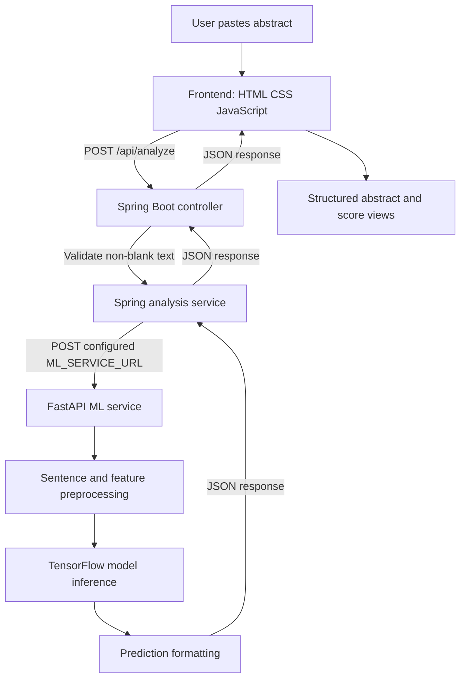

# Structura

## Scientific Abstract Structure Analysis

Structura is a full-stack machine learning application that analyzes scientific abstracts sentence by sentence. It assigns each sentence a structural role, such as `BACKGROUND`, `OBJECTIVE`, `METHODS`, `RESULTS`, or `CONCLUSIONS`, and presents the predictions as a readable structured abstract.

The project is built as three cooperating services:

- A plain HTML, CSS, and JavaScript frontend served by Nginx
- A Spring Boot backend that validates requests and coordinates analysis
- A FastAPI and TensorFlow service that preprocesses text and runs the model

The goal is not to generate or rewrite a scientific abstract. Structura identifies the likely role of each sentence in an existing abstract so that the organization of the research is easier to scan.

> **Project status:** The application flow and inference architecture are implemented. Training history, dataset provenance, evaluation metrics, and deployment information are intentionally left as fill-in sections below because those details are not stored in this repository.

---

## Features

- Sentence-level classification of scientific abstracts
- Five structural classes: `BACKGROUND`, `OBJECTIVE`, `METHODS`, `RESULTS`, and `CONCLUSIONS`
- A primary prediction and an alternative prediction for every sentence
- Confidence scores for both predictions
- Raw five-class probability scores in the API response
- Readable grouping of adjacent sentences with the same predicted class
- Sample medical abstracts covering oncology, cardiology, and neurology
- Light and dark themes with the selected theme saved in browser storage
- Responsive static frontend with no frontend build step
- Docker Compose setup for running the complete application locally
- Separate API and inference services so the model runtime is isolated from the Java backend

---

## What Structura Does

A scientific abstract usually follows a recognizable rhetorical structure. For example, it may begin by explaining a problem, state the purpose of a study, describe how the study was performed, report the findings, and finish with an interpretation or conclusion.

Structura treats each sentence as an individual classification unit. Given an abstract such as:

```text
Heart failure with preserved ejection fraction is a growing public health concern.
This study evaluated whether a new treatment reduced hospitalization.
We analyzed data from 15,000 patients across four clinical trials.
The treatment reduced hospitalization by 22 percent.
These results support its use as a foundational therapy.
```

the model can return a prediction for each sentence:

| Sentence role | Example meaning |
|---|---|
| `BACKGROUND` | Context, motivation, or a problem being addressed |
| `OBJECTIVE` | The aim, question, or purpose of the study |
| `METHODS` | Study design, participants, procedures, or analysis |
| `RESULTS` | Findings, measurements, statistical outcomes, or observations |
| `CONCLUSIONS` | Interpretation, implication, or final claim |

The frontend then groups consecutive sentences with the same predicted class into labeled blocks. This creates a structured view without changing the original sentence text.

---

## User Workflow

1. Open the frontend at `http://localhost:3000` after starting the Docker Compose stack.
2. Paste a scientific abstract into the text area, or select one of the built-in sample abstracts.
3. Select **Analyze abstract**.
4. The frontend sends the text to the Spring Boot API.
5. The Spring Boot service forwards the request to the internal ML service.
6. The ML service splits the abstract into sentences and predicts a class for each sentence.
7. The frontend renders the primary predictions as a structured abstract.
8. Expand the alternative prediction panel to inspect the second most likely class for each sentence.
9. Open **Raw output** to inspect the score assigned to every class.

The **Clear** action removes the input and any displayed result. During inference, the input and analyze button are disabled and a loading state is shown. If the request fails, the frontend logs the error and displays a browser alert.

---

## System Architecture



### Why there are two backend services

The Spring Boot application is the browser-facing application backend. It owns the public `/api/analyze` route, validates the request, and forwards the text to the model service using Spring's `RestClient`.

The FastAPI application owns Python-specific machine learning work. It loads TensorFlow, Keras Hub, spaCy, the model assets, the vocabulary files, and the trained weights. Keeping that runtime separate means the Java application does not need to load TensorFlow or know how the model is assembled.

In Docker Compose, the services communicate over the internal Compose network. The backend uses:

```text
http://ml-service:8000/analyze
```

The browser should normally communicate with the Spring backend, not directly with the ML service.

### Request lifecycle

1. The frontend trims the textarea value and sends `{ "text": "..." }` as JSON.
2. `AbstractAnalysisController` rejects a missing or blank `text` value with HTTP `400`.
3. `AbstractAnalysisService` creates the same request DTO and posts it to `ML_SERVICE_URL`.
4. FastAPI passes the text through `preprocess_text`.
5. The model receives semantic, character-level, and positional features for every sentence.
6. The ML service formats the probability vectors into primary and alternative predictions.
7. The response travels back through Spring to the browser.
8. JavaScript groups adjacent predictions and builds the result interface.

---

## Frontend

The frontend lives in [frontend/index.html](frontend/index.html), [frontend/script.js](frontend/script.js), and [frontend/styles.css](frontend/styles.css). It is intentionally lightweight: there is no React application, package manager, bundler, or frontend compilation step.

### Interface behavior

The page provides:

- A textarea for an abstract
- An analyze button that remains disabled until text is entered
- A clear button
- A loading indicator during the request
- Three prewritten sample abstracts
- A structured result panel
- An alternative predictions panel
- A raw score table
- A light/dark theme toggle
- An educational limitations section

### Rendering predictions

The API returns one result object per sentence. The frontend walks through those objects in order and starts a new visual block whenever the predicted class changes. It does not reorder sentences and it does not ask the model to produce a new abstract.

For each block, the frontend displays:

- The predicted structural category
- The original sentence text
- A mean confidence calculated from the sentences in that block

Alternative predictions use the same grouping logic but substitute `alternative.predictedClass` and `alternative.confidence`.

The raw score table displays the five returned scores in the order:

```text
BACKGROUND, CONCLUSIONS, METHODS, OBJECTIVE, RESULTS
```

The model service returns confidence values as fractions between `0` and `1`. The frontend formats them as percentages for display. The raw score table shows values to six decimal places.

### API URL selection

When the page runs on `localhost` or `127.0.0.1`, JavaScript sends requests to:

```text
http://localhost:8080
```

For GitHub Codespaces-style hostnames ending in `.app.github.dev`, the script changes the forwarded port in the hostname to `8080`. On other hosts it uses the current protocol and a derived backend hostname. This behavior is useful for development environments where frontend and backend ports are forwarded separately.

### Theme persistence

The selected theme is stored under the browser local-storage key:

```text
structura-theme
```

Any value other than `light` defaults to the dark theme on the next page load.

---

## Spring Boot Backend

The backend is a Spring Boot application running on Java 21. Its main responsibility is request coordination rather than model inference.

### Technology

- Java 21
- Spring Boot `4.1.1`
- Spring MVC
- Spring `RestClient`
- Jackson JSON serialization
- Maven Wrapper
- Virtual threads enabled through application configuration

The project also contains JPA, H2, and Actuator dependencies, but the current implementation does not define persistence entities, repositories, or database-backed application features.

### Configuration

The backend binds to all interfaces on port `8080`:

```properties
server.port=8080
server.address=0.0.0.0
```

The ML URL is configurable through the `ML_SERVICE_URL` environment variable:

```properties
structura.ml-service-url=${ML_SERVICE_URL:http://localhost:8000/analyze}
```

The default is appropriate when the ML service is running directly on the host. Docker Compose overrides it with the internal service hostname.

### CORS

The backend allows cross-origin requests for `/api/**` from any origin and allows `GET`, `POST`, `PUT`, `DELETE`, and `OPTIONS`. This is convenient for local development and separately hosted frontends, but a production deployment should narrow the allowed origins when the public frontend URL is known.

---

## Machine Learning Model

This section describes what can be established from the inference code. Training details that are not present in the repository are intentionally marked for completion.

### Model purpose

The model performs five-class sentence classification. It receives an abstract as a collection of sentences and predicts one probability distribution per sentence.

The five output classes are loaded from [ml_service/utilities/class_names.txt](ml_service/utilities/class_names.txt):

```text
BACKGROUND
CONCLUSIONS
METHODS
OBJECTIVE
RESULTS
```

The order of this file is significant because the model's output indices are converted into labels using the same order.

### Implemented architecture

The inference service reconstructs the model in `load_structura_model()` rather than loading a complete executable model object directly. It extracts the vocabulary assets and weight file from `model/structura.keras`, rebuilds the layers, and then restores the trained weights.

The reconstructed model has four input branches.

#### 1. Semantic text branch

The semantic branch uses Keras Hub's `all_minilm_l6_v2_en` BERT backbone through a `BertTextEmbedder`.

The visible configuration includes:

- BERT tokenizer vocabulary extracted from the Keras archive
- Lowercase tokenization
- Accent stripping
- Word-piece suffix indicator `##`
- `[UNK]` out-of-vocabulary token
- Maximum sequence length of `256`
- Round-robin truncation
- Mean pooling
- Normalized embeddings
- Frozen embedder weights during inference
- A dense projection of `128` units with ReLU activation

This branch provides a semantic representation of each sentence. It can represent relationships between words and phrases that are difficult to capture from individual characters alone.

#### 2. Character branch

The character branch operates on a character-spaced version of each sentence:

```text
The study worked.
```

becomes conceptually:

```text
T h e   s t u d y   w o r k e d .
```

The branch contains:

- A `TextVectorization` layer using the extracted character vocabulary
- An embedding layer with output dimension `25`
- A bidirectional LSTM with `32` units per direction

Character-level information can help preserve spelling, punctuation, abbreviations, and domain-specific word shapes.

#### 3. Sentence-position branch

Each sentence receives a zero-based position within the abstract. Positions are one-hot encoded with depth `15` and passed through a dense layer with `32` ReLU units.

This gives the model information about where a sentence occurs. Position can be useful because structured abstracts often follow regular rhetorical ordering.

#### 4. Total-sentence-count branch

The total number of sentences is represented as a one-hot feature with depth `20` and passed through another dense layer with `32` ReLU units.

This gives the model context about the size of the abstract and the relative structural environment in which a sentence appears.

### Classification head

The semantic and character representations are concatenated first. The combined representation is passed through:

- A dense layer with `256` ReLU units
- Dropout with rate `0.5`
- Concatenation with the two positional representations
- A final dense layer with `5` units and softmax activation

The softmax output is a probability vector for one sentence. The highest-probability index becomes the primary prediction. The second-highest probability becomes the alternative prediction.

### Model asset loading

At startup, the ML service expects:

```text
ml_service/model/structura.keras
```

The file is treated as a ZIP archive. The service extracts:

```text
assets/layers/bert_text_embedder_preprocessor/tokenizer/vocabulary.txt
assets/layers/text_vectorization/vocabulary.txt
model.weights.h5
```

The extracted files are written under `ml_service/model_extract/`. The model is loaded once when the FastAPI process starts. If model loading fails, the process prints the exception and exits instead of starting an unusable inference server.

> **Implementation note:** Weight restoration currently uses `skip_mismatch=True`. This allows loading to continue when a weight shape does not match, but it can also hide an incomplete restoration. This should be reviewed before relying on the model for production results.

---

## Model Documentation To Complete

The repository contains the deployed architecture and inference assets, but not the experiment notebook or training pipeline. The following sections are intentionally ready for the model author to complete.

### Dataset and data source

> **To complete:** Describe the dataset name, source URL, license, domain, collection process, number of abstracts, number of sentences, and any filtering or deduplication.

### Label definitions

> **To complete:** Explain the annotation scheme for `BACKGROUND`, `OBJECTIVE`, `METHODS`, `RESULTS`, and `CONCLUSIONS`. Include examples of ambiguous sentences and how multi-role sentences were labeled.

### Train, validation, and test splits

> **To complete:** Add the number of abstracts and sentences in each split. Explain whether the split was performed by sentence, abstract, paper, author, or source dataset. Document the random seed if one was used.

### Training procedure

> **To complete:** Add the loss function, optimizer, learning rate, batch size, number of epochs, callbacks, early stopping behavior, class weighting, augmentation, and hardware used.

### Trainable components

> **To complete:** Explain which branches were frozen or fine-tuned during training. State whether the MiniLM backbone was trained, partially unfrozen, or used only as a fixed feature extractor.

### Evaluation results

> **To complete:** Add accuracy, precision, recall, F1 score, macro and weighted averages, validation results, test results, and any confidence intervals.

| Metric | Validation | Test |
|---|---:|---:|
| Accuracy | TODO | TODO |
| Macro precision | TODO | TODO |
| Macro recall | TODO | TODO |
| Macro F1 | TODO | TODO |

### Per-class performance

> **To complete:** Add a table showing how well the model performs for each structural class and identify the most common class confusions.

| Class | Precision | Recall | F1 score | Support |
|---|---:|---:|---:|---:|
| `BACKGROUND` | TODO | TODO | TODO | TODO |
| `OBJECTIVE` | TODO | TODO | TODO | TODO |
| `METHODS` | TODO | TODO | TODO | TODO |
| `RESULTS` | TODO | TODO | TODO | TODO |
| `CONCLUSIONS` | TODO | TODO | TODO | TODO |

### Confusion matrix

> **To complete:** Add a confusion matrix image and explain the strongest and weakest class boundaries. Pay particular attention to sentences that combine multiple rhetorical roles.

### Confidence interpretation

> **To complete:** Explain whether the returned softmax values were calibrated, whether a confidence threshold was evaluated, and what users should infer from a low-confidence prediction. A softmax score is not automatically a guarantee of correctness.

### Reproducibility

> **To complete:** Add the training code or notebook location, dependency versions, random seeds, preprocessing version, model checksum, and the exact command used to export the deployed model archive.

### Out-of-domain behavior

> **To complete:** Describe how the model behaves on non-scientific text, abstracts outside the training domain, short inputs, unusually long inputs, and sentences containing multiple structural roles.

---

## Inference Preprocessing

The inference pipeline is implemented in [ml_service/utilities/utils.py](ml_service/utilities/utils.py).

### Sentence splitting

The service creates a lightweight English spaCy pipeline and adds spaCy's `sentencizer`. It uses the resulting sentence spans as the model's prediction units.

This is deliberately different from splitting only on newline characters or using a regular expression. Sentence boundaries are determined by the sentencizer, so punctuation and spacing affect how the input becomes a list of sentences.

### Positional features

For an abstract containing `N` sentences, each sentence receives:

- A zero-based line number from `0` to `N - 1`
- A total-line value of `N - 1`

The line numbers are one-hot encoded with depth `15`. The total-line values are one-hot encoded with depth `20`.

These fixed depths are model design constraints. Very long abstracts may produce values outside the intended one-hot ranges and should be tested before being treated as fully supported input.

### Character features

Each sentence is converted to a string containing its characters separated by spaces. The character sequence is then passed through the stored vocabulary and embedding layers.

### Prediction formatting

For each sentence, the ML service:

1. Runs the model and obtains five probabilities.
2. Selects the highest-probability class as `predictedClass`.
3. Selects the second-highest class as `alternative.predictedClass`.
4. Returns the corresponding probabilities as `confidence` values.
5. Returns the complete five-value vector as `rawScores`.

Confidence values in the JSON response are decimals such as `0.9234`, not integer percentages. The frontend multiplies them by `100` when it displays a mean confidence tooltip.

---

## API Reference

### Public endpoint: `POST /api/analyze`

This is the endpoint used by the browser. It is served by Spring Boot on port `8080`.

#### Request

```http
POST /api/analyze
Content-Type: application/json
```

```json
{
  "text": "Heart failure is a growing public health concern. This study evaluated a new treatment."
}
```

#### Example with curl

```bash
curl -X POST http://localhost:8080/api/analyze \
  -H "Content-Type: application/json" \
  -d '{"text":"Heart failure is a growing public health concern. This study evaluated a new treatment."}'
```

#### Response

The response is passed through from the ML service and has this shape:

```json
{
  "success": true,
  "data": [
    {
      "text": "Heart failure is a growing public health concern.",
      "predictedClass": "BACKGROUND",
      "confidence": 0.91,
      "alternative": {
        "predictedClass": "OBJECTIVE",
        "confidence": 0.06
      },
      "rawScores": [0.91, 0.01, 0.01, 0.06, 0.01]
    }
  ],
  "rawOutput": "[[...]]"
}
```

`rawOutput` is currently a string representation of the model probability array. It is preserved in the response for inspection, while `data` contains the structured objects used by the frontend.

#### Request validation

The Spring controller returns HTTP `400 Bad Request` when:

- The request body is missing
- The `text` property is missing
- The `text` property is blank

The controller does not impose a documented maximum character count. The model's positional feature depths still impose practical constraints on very long abstracts.

### Internal endpoint: `POST /analyze`

The FastAPI service exposes the model endpoint directly on port `8000`.

```bash
curl -X POST http://localhost:8000/analyze \
  -H "Content-Type: application/json" \
  -d '{"text":"This study evaluated a new treatment."}'
```

It accepts the same request shape and returns the same response schema. In a deployed environment, this service should generally remain private and receive traffic from the Spring backend over the internal network.

### ML health endpoint: `GET /`

```bash
curl http://localhost:8000/
```

Expected response:

```json
{
  "message": "Welcome to the Text Analysis API!"
}
```

Docker Compose uses this endpoint for the ML service health check.

---

## Docker Compose Deployment

The recommended local setup uses [docker-compose.yml](docker-compose.yml) to run all three services.

| Service | Container port | Host port | Responsibility |
|---|---:|---:|---|
| `frontend` | `80` | `3000` | Serves the browser UI through Nginx |
| `backend` | `8080` | `8080` | Public JSON API and request forwarding |
| `ml-service` | `8000` | `8000` | FastAPI inference service |

### Start the application

From the repository root:

```bash
docker compose up --build
```

Open the application at:

```text
http://localhost:3000
```

The first build or startup can take time because the ML image installs TensorFlow and Keras Hub, and model initialization happens when the FastAPI process starts.

### Compose startup order

The backend waits for the ML service to become healthy. The frontend waits for the backend to become healthy. The intended startup path is therefore:

```text
ml-service -> backend -> frontend
```

The backend receives this Compose-only environment variable:

```text
ML_SERVICE_URL=http://ml-service:8000/analyze
```

### Useful Docker commands

```bash
# Start in the background
docker compose up --build -d

# Follow logs for every service
docker compose logs -f

# Follow only ML service logs
docker compose logs -f ml-service

# Inspect service status
docker compose ps

# Stop and remove the Compose containers
docker compose down

# Rebuild images after changing source or model assets
docker compose build --no-cache
```

### Container details

The backend uses a multi-stage Java image. Maven builds the application with Eclipse Temurin JDK 21, and the runtime image contains only the JRE and packaged application JAR.

The ML service uses a Python 3.11 virtual environment created in a builder stage. The runtime image receives that environment and the complete `ml_service` directory, including the model archive, extracted assets, utility module, and class names.

The frontend copies its three static assets into an Nginx Alpine image. Nginx falls back to `index.html` for unknown paths, allowing the single-page interface to load correctly.

### Deployment checklist

Before deploying outside local development, fill in and verify:

- **Hosting platform:** TODO
- **Public frontend URL:** TODO
- **Backend URL or reverse proxy route:** TODO
- **CPU and memory allocation:** TODO
- **Expected model startup time:** TODO
- **Whether port `8000` is private:** Recommended: yes
- **Allowed CORS origins:** Replace the current wildcard with the production frontend origin
- **Health check behavior:** Confirm the platform allows enough startup time for TensorFlow model loading
- **Model asset storage:** Confirm `model/structura.keras` is included in the deployed image

---

## Local Development Without Docker

Docker Compose is the easiest way to run the complete system. Individual services can also be run manually when debugging.

### Start the ML service

```bash
cd ml_service
python3 -m venv .venv
source .venv/bin/activate
pip install -r requirements.txt
uvicorn main:app --host 0.0.0.0 --port 8000
```

The model archive must be present at `ml_service/model/structura.keras` before startup.

### Start the backend

In a second terminal:

```bash
cd backend
./mvnw spring-boot:run
```

By default, the backend forwards to `http://localhost:8000/analyze`. To use a different ML service:

```bash
ML_SERVICE_URL=http://localhost:8000/analyze ./mvnw spring-boot:run
```

### Serve the frontend

In a third terminal, after the backend is available:

```bash
cd frontend
python3 -m http.server 3000
```

The frontend's localhost behavior sends requests to `http://localhost:8080`.

This simple server is useful for development. The production-like static server is the Nginx container defined by [frontend/Dockerfile](frontend/Dockerfile).

---

## Testing

The repository currently contains a Spring Boot context smoke test:

```bash
cd backend
./mvnw test
```

The existing test verifies that the Spring application context can load. It does not currently cover:

- Controller validation cases
- Backend-to-ML communication
- FastAPI preprocessing
- Model predictions
- Frontend rendering
- Docker health checks
- End-to-end analysis

> **To complete:** Add focused tests for the API contract, sentence preprocessing, score formatting, and an end-to-end request using a small test fixture.

---

## Troubleshooting

### The frontend loads but analysis fails

Check that the backend is running on port `8080` and that the browser is using the expected API URL. Then inspect:

```bash
docker compose logs -f backend
```

### The backend cannot reach the ML service

Inside Docker Compose, `ML_SERVICE_URL` must use the service name:

```text
http://ml-service:8000/analyze
```

`localhost` inside the backend container refers to the backend container itself, not the ML container.

### The ML service exits during startup

Inspect its logs:

```bash
docker compose logs ml-service
```

Common causes include missing `model/structura.keras`, incompatible model assets, insufficient memory, or a dependency installation failure.

### Compose waits indefinitely for the backend

The backend health check depends on port `8080` accepting connections. Check backend logs and confirm that the Java application started successfully. If the image lacks a shell feature required by the health check in a particular runtime environment, the health check may need to be adapted for that environment.

### Blank input returns an error

This is expected. The Spring controller rejects missing or whitespace-only text with HTTP `400`.

### Predictions look unreliable for long abstracts

The model uses fixed one-hot feature depths of `15` for sentence positions and `20` for total-line values. Long inputs should be evaluated against those constraints before being considered supported production input.

### CORS errors appear in the browser

The backend currently allows all origins for `/api/**`, so a CORS error usually indicates that the request is going to the wrong host or port, or that a reverse proxy is changing the response headers. Confirm the frontend's derived API URL and inspect the browser network request.

---

## Limitations

- The model always selects one of five classes; there is no explicit `UNKNOWN` or `MIXED` class.
- A sentence can contain more than one rhetorical role, but the output allows only one primary and one alternative class.
- Sentence boundaries depend on spaCy's sentencizer and may not match the formatting or segmentation expected by every abstract.
- The model uses fixed positional feature dimensions, so unusually long abstracts require validation.
- Softmax confidence should not automatically be interpreted as calibrated probability of correctness.
- The frontend groups only adjacent sentences with the same label. Two separated blocks with the same label remain separate.
- The current backend does not define a custom error response for downstream ML failures.
- CORS is configured broadly for development and should be restricted for a public deployment.
- The repository contains inference assets but not the training pipeline, experiment history, or evaluation reports.
- The current automated test coverage is limited to application-context loading.

---

## Design Decisions

### Sentence-level rather than document-level classification

Classifying each sentence preserves the original wording and makes the result inspectable. Users can see which exact sentence led to each structural label instead of receiving only a document-level summary.

### Hybrid text representation

The model combines a pretrained semantic representation with character-level and positional signals. The semantic branch provides contextual language information, the character branch captures local form, and the positional branches provide abstract-level structure.

### Separate Java and Python services

Spring Boot provides a conventional application boundary for the browser API, while FastAPI keeps the TensorFlow runtime close to the model code. Docker Compose makes the network connection explicit and repeatable.

### Raw scores are preserved

The API returns the full five-class score vector instead of exposing only the winning label. This makes the result easier to inspect and provides a foundation for later calibration, thresholding, or evaluation tooling.

---

## Future Work

- Add the training pipeline and experiment configuration to the repository.
- Document dataset provenance, labeling rules, and model evaluation.
- Add model and API integration tests.
- Add explicit handling for oversized abstracts and sentence-count limits.
- Investigate confidence calibration and an abstention or `MIXED` class.
- Add structured error responses shared by the backend and ML service.
- Restrict CORS to known deployment origins.
- Add request limits and observability for production use.
- Add frontend screenshots and an architecture illustration once final design assets are available.
- Add a deployment configuration for the chosen hosting platform.

---

## Repository Structure

```text
Structura/
├── docker-compose.yml                 # Three-service local orchestration
├── README.md                          # Project documentation
├── frontend/
│   ├── Dockerfile                     # Nginx static-site image
│   ├── nginx.conf                     # Nginx server configuration
│   ├── index.html                     # Application markup and copy
│   ├── script.js                      # Theme, API calls, and result rendering
│   └── styles.css                     # Frontend styling
├── backend/
│   ├── Dockerfile                     # Multi-stage Java image
│   ├── pom.xml                        # Maven and Spring dependencies
│   ├── mvnw                            # Maven Wrapper
│   └── src/
│       ├── main/java/com/aaryan/
│       │   ├── config/CorsConfig.java
│       │   └── structura/
│       │       ├── StructuraApplication.java
│       │       ├── AbstractAnalysisService.java
│       │       ├── controller/
│       │       └── dto/
│       ├── main/resources/application.properties
│       └── test/java/com/aaryan/structura/
├── ml_service/
│   ├── Dockerfile                     # Python runtime image
│   ├── requirements.txt               # ML dependencies
│   ├── main.py                        # FastAPI routes and model assembly
│   ├── model/structura.keras          # Model archive and trained assets
│   ├── model_extract/                 # Extracted vocabularies and weights
│   └── utilities/
│       ├── class_names.txt            # Output class order
│       └── utils.py                   # Preprocessing and formatting
└── LICENSE
```

---

## License

See [LICENSE](LICENSE) for the project license.

---

## Acknowledgements

> **To complete:** Add links and attribution for the dataset, pretrained MiniLM model, Keras Hub components, spaCy, TensorFlow, Spring Boot, FastAPI, and any sources used to create the training labels or sample abstracts.
