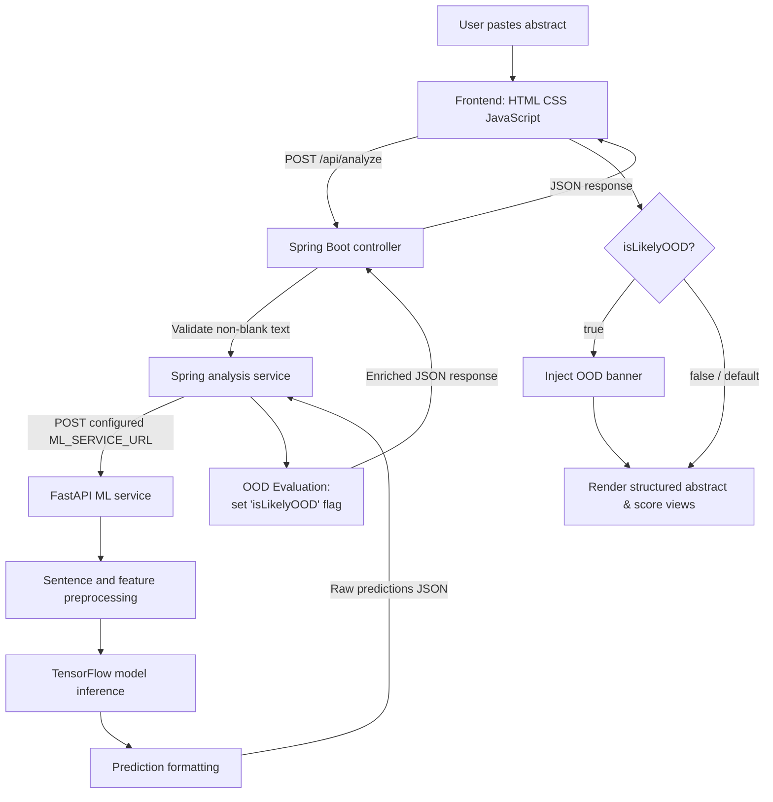
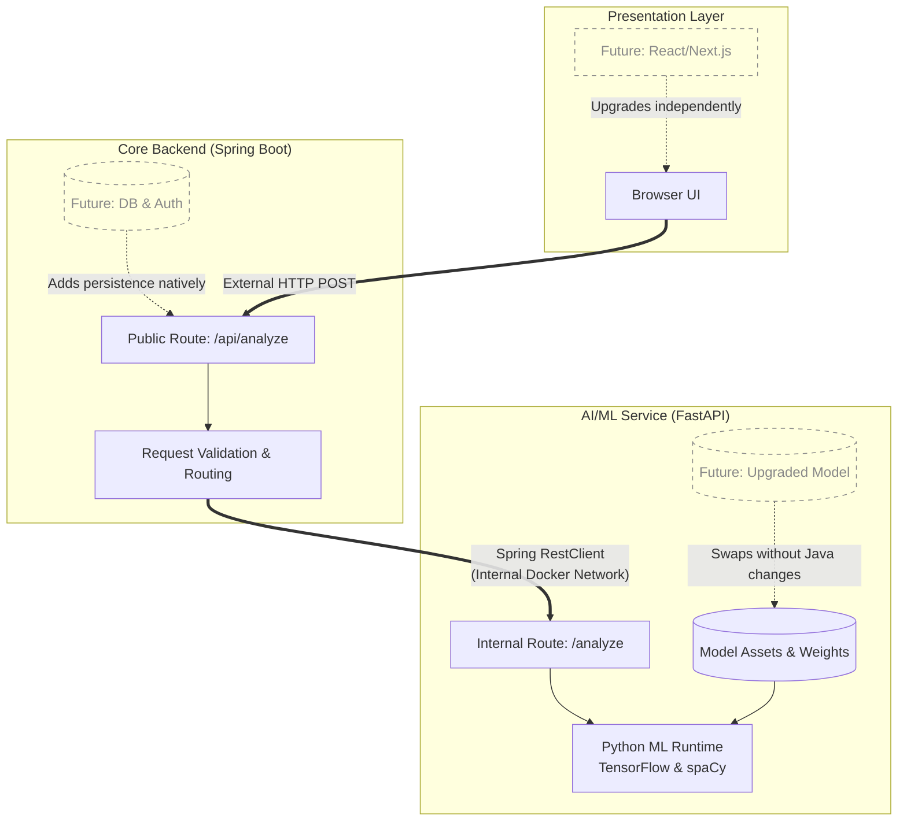
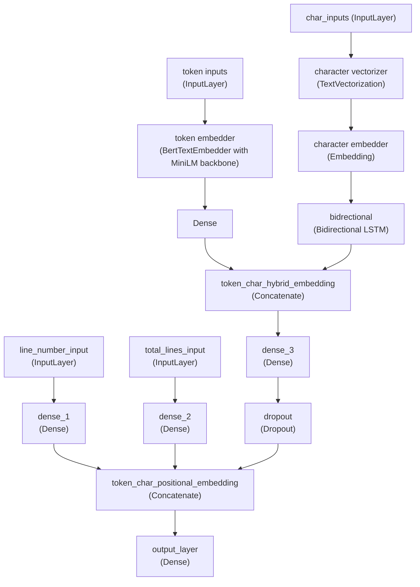

# Structura - Scientific Abstract Structure Analysis

Structura is a full-stack machine learning application that analyzes scientific abstracts sentence by sentence. It assigns each sentence a structural role, such as `BACKGROUND`, `OBJECTIVE`, `METHODS`, `RESULTS`, or `CONCLUSIONS`, and presents the predictions as a readable structured abstract.

The project is built as three cooperating services:

- A plain HTML, CSS, and JavaScript frontend served by Nginx
- A Spring Boot backend that validates requests and coordinates analysis
- A FastAPI and TensorFlow service that preprocesses text and runs the model inference

The goal is not to generate or rewrite a scientific abstract. Structura identifies the likely role of each sentence in an existing abstract so that the organization of the research is easier to scan.

---

# Live Streamlit Demo
Since, deploying the complete project with all of its components is not possible for me (as of 2026) on free tiers on hosting services, specifically the ML service layer. So, what I *did* instead was made a Streamlit application, with similar UI and functionalities as this Full-Stack implementation, and hosted it on Streamlit Community Cloud (for free!), for anyone not wanting to setup this whole thing locally, to explore it, on the fly!

[Check it out](https://structura-app-impl-ltkaydtkesgwkrhmanxwyf.streamlit.app/)!

---

## Features

- Sentence-level classification of scientific abstracts
- Five structural classes: `BACKGROUND`, `OBJECTIVE`, `METHODS`, `RESULTS`, and `CONCLUSIONS`
- A primary prediction and an alternative prediction for every sentence
- Confidence scores for both predictions
  
<br>

- Raw five-class probability scores in the API response and UI

<br>

**API RESPONSE FOR THE ABOVE SAMPLE**
<div style="margin-left: 17.5%; width: 80%; overflow: auto;">

```json
{
  "success": true,
  "data": [
    {
      "text": "Chronic low back pain remains a major cause of disability worldwide, with limited long-term efficacy from standard physical therapies.",
      "predictedClass": "BACKGROUND",
      "confidence": 0.6914839148521423,
      "alternative": {
        "predictedClass": "OBJECTIVE",
        "confidence": 0.11462412029504776
      },
      "rawScores": [
        0.6914839148521423,
        0.10128433257341385,
        0.036723311990499496,
        0.11462412029504776,
        0.055884331464767456
      ]
    },
    {
      "text": "We aimed to evaluate whether an 8-week mindfulness-based stress reduction (MBSR) program reduces pain intensity compared to usual care.",
      "predictedClass": "OBJECTIVE",
      "confidence": 0.6512438058853149,
      "alternative": {
        "predictedClass": "BACKGROUND",
        "confidence": 0.26813048124313354
      },
      "rawScores": [
        0.26813048124313354,
        0.031246602535247803,
        0.02932562679052353,
        0.6512438058853149,
        0.02005341835319996
      ]
    },
    {
      "text": "A randomized, parallel-group trial was conducted with 240 adults aged 18 to 65 years diagnosed with persistent non-specific low back pain.",
      "predictedClass": "METHODS",
      "confidence": 0.8127331137657166,
      "alternative": {
        "predictedClass": "CONCLUSIONS",
        "confidence": 0.0701058879494667
      },
      "rawScores": [
        0.037877969443798065,
        0.0701058879494667,
        0.8127331137657166,
        0.03680719807744026,
        0.042475901544094086
      ]
    },
    {
      "text": "Participants were randomly assigned 1:1 to either the MBSR group or a waitlist control receiving standard medical care.",
      "predictedClass": "METHODS",
      "confidence": 0.8258354663848877,
      "alternative": {
        "predictedClass": "CONCLUSIONS",
        "confidence": 0.0656890720129013
      },
      "rawScores": [
        0.029055284336209297,
        0.0656890720129013,
        0.8258354663848877,
        0.03681573271751404,
        0.0426044762134552
      ]
    },
    {
      "text": "The primary outcome was the change in back pain intensity measured on a 10-point visual analog scale at 24 weeks.",
      "predictedClass": "METHODS",
      "confidence": 0.8740441203117371,
      "alternative": {
        "predictedClass": "CONCLUSIONS",
        "confidence": 0.038470081984996796
      },
      "rawScores": [
        0.0297878235578537,
        0.038470081984996796,
        0.8740441203117371,
        0.037222184240818024,
        0.02047572284936905
      ]
    },
    {
      "text": "A total of 218 participants completed the final 24-week follow-up assessment.",
      "predictedClass": "RESULTS",
      "confidence": 0.6778584122657776,
      "alternative": {
        "predictedClass": "METHODS",
        "confidence": 0.19731244444847107
      },
      "rawScores": [
        0.025561530143022537,
        0.06460944563150406,
        0.19731244444847107,
        0.03465818986296654,
        0.6778584122657776
      ]
    },
    {
      "text": "The MBSR group demonstrated a significant reduction in pain scores compared to the control group (mean difference -1.4 points; 95% CI, -1.9 to -0.9; P < 0.001).",
      "predictedClass": "RESULTS",
      "confidence": 0.8646373748779297,
      "alternative": {
        "predictedClass": "METHODS",
        "confidence": 0.03808224946260452
      },
      "rawScores": [
        0.028153561055660248,
        0.037246301770210266,
        0.03808224946260452,
        0.03188057616353035,
        0.8646373748779297
      ]
    },
    {
      "text": "No serious adverse events associated with the intervention were reported during the trial period.",
      "predictedClass": "RESULTS",
      "confidence": 0.8739274144172668,
      "alternative": {
        "predictedClass": "CONCLUSIONS",
        "confidence": 0.038773857057094574
      },
      "rawScores": [
        0.02140018530189991,
        0.038773857057094574,
        0.03660152852535248,
        0.02929692715406418,
        0.8739274144172668
      ]
    },
    {
      "text": "An 8-week MBSR program provides clinically meaningful, sustained improvement in pain and functional limitations for patients with chronic low back pain.",
      "predictedClass": "CONCLUSIONS",
      "confidence": 0.8548111319541931,
      "alternative": {
        "predictedClass": "METHODS",
        "confidence": 0.04126443713903427
      },
      "rawScores": [
        0.036142196506261826,
        0.8548111319541931,
        0.04126443713903427,
        0.030422033742070198,
        0.037360113114118576
      ]
    }
  ],
  "rawOutput": "[[0.6914839  0.10128433 0.03672331 0.11462412 0.05588433]\n [0.26813048 0.0312466  0.02932563 0.6512438  0.02005342]\n [0.03787797 0.07010589 0.8127331  0.0368072  0.0424759 ]\n [0.02905528 0.06568907 0.82583547 0.03681573 0.04260448]\n [0.02978782 0.03847008 0.8740441  0.03722218 0.02047572]\n [0.02556153 0.06460945 0.19731244 0.03465819 0.6778584 ]\n [0.02815356 0.0372463  0.03808225 0.03188058 0.8646374 ]\n [0.02140019 0.03877386 0.03660153 0.02929693 0.8739274 ]\n [0.0361422  0.85481113 0.04126444 0.03042203 0.03736011]]"
}
```

</div>

  
<br>

- Readable grouping of adjacent sentences with the same predicted class
- Sample medical abstracts covering Orthopedics, Endocrinology, Pulmonology, and also an OOD (Out Of Domain) example of Robotics, to give a very rough idea of how the model performs on abstracts of similar structure to an RCT (Randomized Controlled Trial) but not neccessarily from a medical research paper.

- Docker Compose setup for running the complete application locally

- Separate API and inference services so the model runtime is isolated from the Java backend

---

## What Structura Does


A scientific abstract usually follows a recognizable rhetorical structure. For example, it may begin by explaining a problem, state the purpose of a study, describe how the study was performed, report the findings, and finish with an interpretation or conclusion.

Structura treats each sentence as an individual classification unit. Given an abstract such as:

```text
Chronic low back pain remains a major cause of disability worldwide, with limited long-term efficacy from standard physical therapies. We aimed to evaluate whether an 8-week mindfulness-based stress reduction (MBSR) program reduces pain intensity compared to usual care. A randomized, parallel-group trial was conducted with 240 adults aged 18 to 65 years diagnosed with persistent non-specific low back pain. Participants were randomly assigned 1:1 to either the MBSR group or a waitlist control receiving standard medical care. The primary outcome was the change in back pain intensity measured on a 10-point visual analog scale at 24 weeks. A total of 218 participants completed the final 24-week follow-up assessment. The MBSR group demonstrated a significant reduction in pain scores compared to the control group (mean difference -1.4 points; 95% CI, -1.9 to -0.9; P < 0.001). No serious adverse events associated with the intervention were reported during the trial period. An 8-week MBSR program provides clinically meaningful, sustained improvement in pain and functional limitations for patients with chronic low back pain.
```

the model can return a prediction for each sentence:

| Sentence role | Example meaning |
|---|---|
| `BACKGROUND` | Context, motivation, or a problem being addressed |
| `OBJECTIVE` | The aim, question, or purpose of the study |
| `METHODS` | Study design, participants, procedures, or analysis |
| `RESULTS` | Findings, measurements, statistical outcomes, or observations |
| `CONCLUSIONS` | Interpretation, implication, or final claim |

The frontend then groups consecutive sentences with the same predicted class into labeled blocks. This creates a structured view without changing the original sentence text.

---

## User Workflow

1. Open the frontend at `http://localhost:3000` after starting the Docker Compose stack.
2. Paste a scientific abstract into the text area, or select one of the built-in sample abstracts.
3. Select **Analyze abstract**.
4. The frontend sends the text to the Spring Boot API.
5. The Spring Boot service forwards the request to the internal ML service.
6. The ML service splits the abstract into sentences and predicts a class for each sentence.
7. The frontend renders the primary predictions as a structured abstract.
8. Expand the alternative prediction panel to inspect the second most likely class for each sentence.
9. Open **Raw output** to inspect the score assigned to every class.

The **Clear** action removes the input and any displayed result. During inference, the input and analyze button are disabled and a loading state is shown. If the request fails, the frontend logs the error and displays a browser alert.

---

## System Architecture



### Why there are two backend services

The Spring Boot application is the browser-facing application backend. It owns the public `/api/analyze` route, validates the request, and forwards the text to the model service using Spring's `RestClient`.

The FastAPI application owns Python-specific machine learning work. It loads TensorFlow, Keras Hub, spaCy, the model assets, the vocabulary files, and the trained weights. Keeping that runtime separate means the Java application does not need to load TensorFlow or know how the model is assembled.

In Docker Compose, the services communicate over the internal Compose network. The backend uses:

```text
http://ml-service:8000/analyze
```

The browser should normally communicate with the Spring backend, not directly with the ML service.

Now, many of you may think that the SpringBoot layer is basically just a pass through layer, doing nothing except validating whether an actual text content is being passed, one can very easily do the exact same thing in FastAPI using PyDantic models or even just raw FastAPI if they want, then what's the point?

And you are right, there is no major benifit having that SpringBoot layer **currently**.

You see most large scale enterprise softwares *still* use springboot as their main backend with no plans to migrate away from it due to its unmatched efficiency, robust ecosystem, and proven capacity to handle massive, high-throughput applications, this includes **Enterprise Banking**, **Financial Services**, and **Insurance (BFSI)** along with **Large-Scale E-commerce / Retail Tech**.
Rather than rewriting their core infrastructure in Python to adopt AI/ML features, these industries universally prefer a polyglot microservices architecture.

And that is what I have begun learning through Structura.

This **de-coupled** architecture gives me immense flexibility. If I ever upgrade my model, I would just have to edit the ML service layer accordingly, without ever needing the touch the backend or presentation layer.
If I ever decide to add a persistence layer as well using a DB, having user auth and history, i would just have to deal with the SpringBoot code, without needing to worry about making the ML part of the app to be compatible. Or say if i upgrade my frontend to a larger framework like React, i won't even bother looking at the backend and ml service code, they would just work as intended (obviously given i correctly manage to connect to the springboot backend correctly).



I hope you are slowly starting to get the idea of how much potential a de-coupled architecture holds.

### Request lifecycle

1. The frontend trims the textarea value and sends `{ "text": "..." }` as JSON.
2. `AbstractAnalysisController` rejects a missing or blank `text` value with HTTP `400`.
3. `AbstractAnalysisService` creates the same request DTO and posts it to `ML_SERVICE_URL`.
4. FastAPI passes the text through `preprocess_text`.
5. The model receives semantic, character-level, and positional features for every sentence.
6. The ML service formats the probability vectors into primary and alternative predictions.
7. The response travels back to Spring which performs heuristic-driven OOD preprocessing.
8. The response along with preprocessing result travels back to the frontend in JSON format.
9. JavaScript groups adjacent predictions and builds the appropriate result interface based on the OOD preprocessing result.

---

## Frontend


The frontend lives in [frontend/index.html](frontend/index.html), [frontend/script.js](frontend/script.js), and [frontend/styles.css](frontend/styles.css). It is intentionally lightweight: there is no framework application, package manager, bundler, or frontend compilation step.

### Interface behavior

The page provides:

- A textarea for an abstract
- An analyze button that remains disabled until text is entered
- A clear button
- A loading indicator during the request
- Three prewritten sample abstracts
- A structured result panel
- An alternative predictions panel
- A raw score table
- A light/dark theme toggle
- An educational limitations section

  
<br>

### Rendering predictions

The API returns one result object per sentence. The frontend walks through those objects in order and starts a new visual block whenever the predicted class changes. It does not reorder sentences and it does not ask the model to produce a new abstract.

For each block, the frontend displays:

- The predicted structural category
- The original sentence text
- A mean confidence calculated from the sentences in that block

Alternative predictions use the same grouping logic but substitute `alternative.predictedClass` and `alternative.confidence`.

The raw score table displays the five returned scores in the order:

```text
BACKGROUND, CONCLUSIONS, METHODS, OBJECTIVE, RESULTS
```

The model service returns confidence values as fractions between `0` and `1`. The frontend formats them as percentages for display. The raw score table shows values to six decimal places.

  
<br>

### API URL selection

When the page runs on `localhost` or `127.0.0.1`, JavaScript sends requests to:

```text
http://localhost:8080
```

For GitHub Codespaces-style hostnames ending in `.app.github.dev`, the script changes the forwarded port in the hostname to `8080`. On other hosts it uses the current protocol and a derived backend hostname. This behavior is useful for development environments where frontend and backend ports are forwarded separately.

### Theme persistence

The selected theme is stored under the browser local-storage key:

```text
structura-theme
```

Any value other than `light` defaults to the dark theme on the next page load.

---

## Spring Boot Backend


The backend is a Spring Boot application running on Java 21. Its main responsibility is request coordination rather than model inference.

### Technology

- Java 21
- Spring Boot `4.1.1`
- Spring MVC
- Spring `RestClient`
- Jackson JSON serialization
- Maven Wrapper
- Virtual threads enabled through application configuration

### Configuration

The backend binds to all interfaces on port `8080`:

```properties
server.port=8080
server.address=0.0.0.0
```

The ML URL is configurable through the `ML_SERVICE_URL` environment variable:

```properties
structura.ml-service-url=${ML_SERVICE_URL:http://localhost:8000/analyze}
```

The default is appropriate when the ML service is running directly on the host. Docker Compose overrides it with the internal service hostname.

### CORS

The backend allows cross-origin requests for `/api/**` from any origin and allows `GET`, `POST`, `PUT`, `DELETE`, and `OPTIONS`. This is convenient for local development and separately hosted frontends, but a production deployment should narrow the allowed origins when the public frontend URL is known.

---

## Deep Learning Model


All models were built with TensorFlow/Keras. 

Structura is a five-class sentence classifier for scientific abstracts. The deployed model combines semantic, character-level, and positional features. The training history below records the experiments used to select the production architecture, while the implementation details describe the model reconstructed by the inference service.

### Dataset


The source of the dataset and my training goals come from this [**Research Paper**](https://www.google.com/url?q=https%3A%2F%2Farxiv.org%2Fabs%2F1710.06071)

Training used the PubMed 20k RCT dataset from the official [pubmed-rct repository](https://github.com/Franck-Dernoncourt/pubmed-rct). All experiments used the prepared PubMed 20k split with numbers replaced by `@` and the provided training, validation, and test partitions. Each sentence is labeled according to its rhetorical role in the abstract:

- `BACKGROUND`
- `OBJECTIVE`
- `METHODS`
- `RESULTS`
- `CONCLUSIONS`

The partitions contain **180,040** training sentences, **30,212** validation sentences, and **30,135** test sentences. The training distribution was:

| Class | Training sentences |
|---|---:|
| `METHODS` | 59,353 |
| `RESULTS` | 57,953 |
| `CONCLUSIONS` | 27,168 |
| `BACKGROUND` | 21,727 |
| `OBJECTIVE` | 13,839 |

`OBJECTIVE` is the least represented class and was frequently confused with `BACKGROUND`.

### Model purpose

The model performs five-class sentence classification. It receives an abstract as a collection of sentences and predicts one probability distribution per sentence.

The five output classes are loaded from [ml_service/utilities/class_names.txt](ml_service/utilities/class_names.txt):

```text
BACKGROUND
CONCLUSIONS
METHODS
OBJECTIVE
RESULTS
```

The order of this file is significant because the model's output indices are converted into labels using the same order.

### Implemented architecture


This research paper is the source of where my final model architecutre is inspired from:
> [Neural Networks for Joint Sentence Classification in Medical Paper Abstracts by Dernoncourt, 2017](https://www.google.com/url?q=https%3A%2F%2Farxiv.org%2Fpdf%2F1612.05251.pdf)

The inference service reconstructs the model in `load_structura_model()` rather than loading a complete executable model object directly. It extracts the vocabulary assets and weight file from `model/structura.keras`, rebuilds the layers, and then restores the trained weights. This is done inorder to make the loaded model take less memory than just simply loading it, because reconstructing through model weights gave me the ability to skip optimizer weights entirely.

This is a "multi-modal" architecture because the model has four input branches.


#### 1. Semantic text branch


The semantic branch uses Keras Hub's `all_minilm_l6_v2_en` BERT backbone through a `BertTextEmbedder`.

The configuration includes:

- BERT tokenizer vocabulary extracted from the Keras archive
- Lowercase tokenization
- Accent stripping
- Word-piece suffix indicator `##`
- `[UNK]` out-of-vocabulary token
- Maximum sequence length of `256`
- Round-robin truncation
- Mean pooling
- Normalized embeddings
- Frozen embedder weights during inference
- A dense projection of `128` units with ReLU activation

This branch provides a semantic representation of each sentence. It can represent relationships between words and phrases that are difficult to capture from individual characters alone.

#### 2. Character branch


The character branch operates on a character-spaced version of each sentence:

```text
The study worked.
```

becomes conceptually:

```text
T h e   s t u d y   w o r k e d .
```

The branch contains:

- A `TextVectorization` layer using the extracted character vocabulary
- An embedding layer with output dimension `25`
- A bidirectional LSTM with `32` units per direction

Character-level information can help preserve spelling, punctuation, abbreviations, and domain-specific word shapes.

#### 3. Sentence-position branch


Each sentence receives a zero-based position within the abstract. Positions are one-hot encoded with depth `15` and passed through a dense layer with `32` ReLU units.

This gives the model information about where a sentence occurs. Position can be useful because structured abstracts often follow regular rhetorical ordering.

#### 4. Total-sentence-count branch


The total number of sentences is represented as a one-hot feature with depth `20` and passed through another dense layer with `32` ReLU units.

This gives the model context about the size of the abstract and the relative structural environment in which a sentence appears.

This also means that abstracts somehow longer than 20 sentences, will be truncated down to 20, and will also be flagged by Structura as OOD (Out Of Domain).

### Classification head


The semantic and character representations are concatenated first. The combined representation is passed through:

- A dense layer with `256` ReLU units
- Dropout with rate `0.5`
- Concatenation with the two positional representations
- A final dense layer with `5` units and softmax activation

The softmax output is a probability vector for one sentence. The highest-probability index becomes the primary prediction. The second-highest probability becomes the alternative prediction.

### Model asset loading


At startup, the ML service expects:

```text
ml_service/model/structura.keras
```

The file is treated as a ZIP archive. The service extracts:

```text
assets/layers/bert_text_embedder_preprocessor/tokenizer/vocabulary.txt
assets/layers/text_vectorization/vocabulary.txt
model.weights.h5
```

The extracted files are written under `ml_service/model_extract/`. The model is loaded once when the FastAPI process starts. If model loading fails, the process prints the exception and exits instead of starting an unusable inference server.

---

### Experimental protocol

The initial architecture experiments were performed on 10% of the training data to keep iteration times manageable. The experiments were used for architecture selection rather than as directly comparable full-data benchmarks. Validation was performed on the complete validation split where noted in the original experiments. The early models were developed with Keras 2; the production model was later rebuilt for Keras 3 and memory-constrained inference.

The documented token experiment used batches of 32 with TensorFlow datasets and prefetching.

---

### Architecture experiments


| Experiment | Main architecture | Validation accuracy | Validation F1 |
|---|---|---:|---:|
| Baseline | TF-IDF plus Multinomial Naive Bayes | 72.18% | 69.89% |
| Token model | TextVectorization, token embedding, Conv1D, global average pooling | 78.71% | 78.47% |
| Pretrained feature extractor | Universal Sentence Encoder plus dense classifier | 71.52% | 71.23% |
| Character model | Character embedding, Conv1D, global max pooling | 64.82% | 63.67% |
| Hybrid model | Universal Sentence Encoder plus character BiLSTM | 73.48% | 73.11% |
| Tribrid model | Token and character features plus sentence-position features | 83.28% | 83.20% |

The tribrid model combined token semantics, character patterns, the sentence's position, and the abstract's total sentence count. Its initial held-out test evaluation achieved 82.57% accuracy, 82.43% precision, 82.57% recall, and 82.47% F1. These results motivated the later MiniLM-based redesign for deployment.

---

### MiniLM model evolution


The deployed model uses Keras Hub's `all_minilm_l6_v2_en` backbone. It was selected because it provided stronger semantic representations with a much smaller serving footprint than the earlier Universal Sentence Encoder/SavedModel approach (~ 80 MB vs close to 1GB for the USE based model).

| Experiment | Change | Validation result |
|---|---|---:|
| MiniLM 1 | Frozen MiniLM with character BiLSTM and positional branches; 10% training data | 83.62% accuracy, 0.9314 loss |
| MiniLM 2 | Same architecture trained on the full training split for five epochs | 86.47% accuracy, 0.8849 loss |
| MiniLM 3 | Added early stopping and learning-rate reduction | 86.40% accuracy, 0.8933 loss |
| MiniLM 4 | Fine-tuned the MiniLM backbone | 89.45% accuracy, 0.8415 loss |
| MiniLM 5 | Replaced the character BiLSTM with Conv1D | 89.15% accuracy after fine-tuning |
| MiniLM 6 | Final full-data model with MiniLM and character BiLSTM | 89.04% test accuracy |

The Conv1D character branch was retained as an ablation. The final production model uses the character BiLSTM because it performed better in the reported experiments.

---

### Final training configuration

The final model uses categorical cross-entropy with label smoothing of `0.2`, an Adam optimizer, and a `0.5` dropout layer in the classification head. The fine-tuning configuration used Adam with a learning rate of `1e-3` and gradient `clipnorm=1.0`.

The callback configuration was:

- `EarlyStopping` monitoring `val_accuracy`, with patience `3` and `restore_best_weights=True`
- `ReduceLROnPlateau` monitoring `val_loss`, with factor `0.5`, patience `2`, and minimum learning rate `1e-6`

Ok let me explain the jargon I just spilled here in simpler terms.

#### **Label Smoothing**
Prevents the model from being overly confident.

For classification problems using softmax output layer, each confidence prediction is represented as a probability, in Structura's case, the output is a 5D vector for 5 classes.

Now, the ideal case would be for the model to match the true labels, for example, if true label for a sentence is `[1. 0. 0. 0. 0]` (Sentence has `BACKGROUND` as its true label), the model will try to push itself to the hard limit of 1 (100% confidence), driving the logit weights to extreme positive or negative values trying to be highly accurate.

Label smoothing prevents exactly that, by modifying these hard probability targets into *softer* targets, instead of targetting `[1, 0, 0, 0, 0]` for sentence A, label smoothing will change it to something like `[0.9, 0.025, 0.025, 0.025, 0.025]` depending on the smoothing factor selected.

If you set the label_smoothing hyperparameter to α (where α is a float between 0 and 1), Keras modifies the true target distribution y_true using this internal formula:

  
<br>

*(where K is the total number of classes)*

So, continuing our example, we can plug in values in the forumula as such,
* `y_true` = `[1, 0, 0, 0, 0]` (`BACKGROUND`)
* `α` = `0.2` (value which I used)
* K = 5

We get our target as `[0.84, 0.04, 0.04, 0.04, 0.04]` instead of `[1.0, 0.0, 0.0, 0.0, 0.0]`

While an alpha of `0.1` is standard, a more aggressive label smoothing factor of `0.2` was selected due to the inherent structure of the PubMed 20k dataset. Sequential sentences in medical abstracts often exhibit high class ambiguity at transition boundaries (e.g., Background vs. Objective). 

By relaxing the targets to [0.84, 0.04, 0.04, 0.04, 0.04], I introduced two distinct advantages:
1. Regularization: Prevented the distilled MiniLM backbone from overfitting or inflating its output logits on highly structured inputs.
2. Balance: Successfully counteracted the potential dominance of the structural metadata inputs (line positions), forcing the network to retain a balanced reliance on both text semantics and position features.

The resulting narrow gap between overall Accuracy `(89.04%)` and macro F1-score `(88.92%)` proves that the model did not suffer from underfitting or severe class imbalances under this regularization constraint.

#### **Gradient Clipnorm**

Setting Clipnorm to a value (`1.0` in my case) means that the total magnitude (L2 norm) of the gradient vector for each weight matrix is capped at a maximum value of 1.0.

If the calculated gradient's norm is greater than 1.0 during backpropagation, Keras will uniformly scale down all the individual gradients within that vector so that the overall norm becomome exactly 1.0.

Reason to use this here is that NLP models are highly prone to a phenomenon called **exploding  gradient problem.**

NLP models process long sequential data (sentences/paragraphs). During backpropagation, error gradients are multiplied repeatedly across many time steps or attention layers. If the weights are even slightly large, these repeated multiplications cause the gradients to grow exponentially. This leads to wild weight updates, training divergence, and the dreaded NaN (Not a Number) loss errors.

`clipnorm=1.0` acts as a mathematical "governor" or speed limit. It guarantees that even if a specific batch of text generates a massive, unstable error spike, the model will only take a controlled, safely sized step toward optimization.

When clipnorm=1.0 is applied, the framework monitors the L2 norm (Euclidean length) of the gradient vector (g):

  
<br>

* If the norm is 0.75: Nothing changes. The gradients are applied exactly as calculated.
* If the norm is 5.0: The entire vector is scaled down by dividing all values by 5.0.

Because the whole vector is scaled down by the same ratio, the direction of the gradient optimization step stays exactly the same. Only the length (magnitude) is shortened.

---

The final reported result was evaluated on the test split, which was **not** used during model selection:

| Metric | Final test result |
|---|---:|
| Accuracy | 89.04% |
| Precision | 88.91% |
| Recall | 89.04% |
| F1 score | 88.92% |

---

### Confusion Matrix


The confusion matrix gives a class-by-class view of the final model's test performance. The rows represent the true labels, while the columns represent the labels predicted by the model. The large values along the diagonal show that the model learned the overall structure of scientific abstracts well, especially for `METHODS`, `RESULTS`, and `CONCLUSIONS`.

- **BACKGROUND**: The model correctly classified 2,910 sentences. The main source of confusion was `OBJECTIVE` (499 sentences), followed by `METHODS` (177). This is understandable because background sentences and objective statements can appear next to each other at the beginning of an abstract and may share similar wording.
- **CONCLUSIONS**: The model correctly classified 4,103 sentences. The most frequent misclassification was as `RESULTS` (397 sentences), which reflects the semantic similarity between reporting the final findings and interpreting those findings at the end of an abstract.
- **METHODS**: This was the strongest-performing class, with 9,471 correct predictions. Only a small number of sentences were confused with `RESULTS` (278), `BACKGROUND` (75), or `OBJECTIVE` (44), showing that procedural language was generally distinctive enough for the model to recognize.
- **OBJECTIVE**: This was the most difficult class for the model. Out of 2,333 true objective sentences, 1,432 were classified correctly, while 779 were predicted as `BACKGROUND`. Objective statements often occur immediately after the background and can use similar syntactic and contextual patterns, which explains this specific confusion.
- **RESULTS**: The model correctly classified 8,917 sentences. The most common errors were predictions as `METHODS` (498) and `CONCLUSIONS` (285). This suggests that sentences describing experimental procedures or summarizing findings can sometimes overlap in vocabulary and structure.

Overall, the matrix supports the final test accuracy of `89.04%` and macro F1 score of `88.92%`. Most errors occur between neighboring or semantically related sections rather than between unrelated classes. The main area for improvement is distinguishing `OBJECTIVE` from `BACKGROUND`, while the high number of correct `METHODS` and `RESULTS` predictions shows that the model handles the more explicitly structured parts of abstracts particularly well.

---

### Deployment considerations

The earlier Keras 2 SavedModel approach created a large model (~990MB) and could consume several gigabytes of memory during loading. That was unsuitable for the intended low-memory deployment environment, and for a live streamlit community cloud deployment.

The MiniLM redesign reduced the model assets to approximately 80 MB before the final archive and enabled a Keras 3-compatible reconstruction from the stored vocabularies and `model.weights.h5` weights.

The production loader extracts the tokenizer vocabulary, character vocabulary, and weights from the `.keras` archive, reconstructs the architecture, freezes the MiniLM embedder for inference, and restores the trained weights. Inference is configured for CPU use. The loader currently passes `skip_mismatch=True` to `load_weights`; this keeps startup from failing on a mismatch but can conceal incomplete weight restoration and should be audited when changing the architecture.

### Known Limitations


- Position features use fixed one-hot depths of `15` for the zero-based sentence position and `20` for the encoded total-line value. Very long abstracts can exceed these ranges and therefore be truncated.
- The model is most likely to confuse `OBJECTIVE` and `BACKGROUND`, partly reflecting the training imbalance.
- Behavior on non-scientific text, out-of-domain abstracts, and sentences containing multiple rhetorical roles was not systematically evaluated.
- The model always selects one of five classes; there is no explicit `UNKNOWN` or `MIXED` class.
- A sentence can contain more than one rhetorical role, but the output allows only one primary and one alternative class.
- Sentence boundaries depend on spaCy's sentencizer and may not match the formatting or segmentation expected by every abstract.
- Softmax confidence should not automatically be interpreted as calibrated probability of correctness.
- The current backend does not define a custom error response for downstream ML failures.
- CORS is configured broadly for development and should be restricted for a public deployment.

---

## Inference Preprocessing

The inference pipeline is implemented in [ml_service/utilities/utils.py](ml_service/utilities/utils.py).

### Sentence splitting


The service creates a lightweight English spaCy pipeline and adds spaCy's `sentencizer`. It uses the resulting sentence spans as the model's prediction units.

This is deliberately different from splitting only on newline characters or using a regular expression. Sentence boundaries are determined by the sentencizer, so punctuation and spacing affect how the input becomes a list of sentences.

### Positional features


For an abstract containing `N` sentences, each sentence receives:

- A zero-based line number from `0` to `N - 1`
- A total-line value of `N - 1`

The line numbers are one-hot encoded with depth `15`. The total-line values are one-hot encoded with depth `20`.

These fixed depths are model design constraints. Very long abstracts may produce values outside the intended one-hot ranges and should be tested before being treated as fully supported input.

### Character features


Each sentence is converted to a string containing its characters separated by spaces. The character sequence is then passed through the stored vocabulary and embedding layers.

### Prediction formatting


For each sentence, the ML service:

1. Runs the model and obtains five probabilities.
2. Selects the highest-probability class as `predictedClass`.
3. Selects the second-highest class as `alternative.predictedClass`.
4. Returns the corresponding probabilities as `confidence` values.
5. Returns the complete five-value vector as `rawScores`.

Confidence values in the JSON response are decimals such as `0.9234`, not integer percentages. The frontend multiplies them by `100` when it displays a mean confidence tooltip.

---

## API Reference


### Public endpoint: `POST /api/analyze`

This is the endpoint used by the browser. It is served by Spring Boot on port `8080`.

#### Request

```http
POST /api/analyze
Content-Type: application/json
```

```json
{
  "text": "Heart failure is a growing public health concern. This study evaluated a new treatment."
}
```

#### Example with curl

```bash
curl -X POST http://localhost:8080/api/analyze \
  -H "Content-Type: application/json" \
  -d '{"text":"Heart failure is a growing public health concern. This study evaluated a new treatment."}'
```

#### Response

The response is passed through from the ML service and has this shape:

```json
{
  "success": true,
  "data": [
    {
      "text": "Heart failure is a growing public health concern.",
      "predictedClass": "BACKGROUND",
      "confidence": 0.91,
      "alternative": {
        "predictedClass": "OBJECTIVE",
        "confidence": 0.06
      },
      "rawScores": [0.91, 0.01, 0.01, 0.06, 0.01]
    }
  ],
  "rawOutput": "[[...]]",
  "isLikelyOOD": false
}
```

`rawOutput` is currently a string representation of the model probability array. It is preserved in the response for inspection, while `data` contains the structured objects used by the frontend.

`isLikelyOOD` is `true` when any of the following backend checks indicates that the input is likely outside the model's supported domain:

- Mean primary sentence confidence is below `0.45`.
- The adjacent predicted-class change rate is at least `0.67`.
- The parsed sentence count is fewer than `3` or greater than `30`.

The sentence count uses the same sentence-level results produced by the FastAPI service. The frontend can use this boolean to choose the appropriate user-facing message.

#### Request validation

The Spring controller returns HTTP `400 Bad Request` when:

- The request body is missing
- The `text` property is missing
- The `text` property is blank

The controller does not impose a documented maximum character count. The model's positional feature depths still impose practical constraints on very long abstracts.

### Internal endpoint: `POST /analyze`

The FastAPI service exposes the model endpoint directly on port `8000`.

```bash
curl -X POST http://localhost:8000/analyze \
  -H "Content-Type: application/json" \
  -d '{"text":"This study evaluated a new treatment."}'
```

It accepts the same request shape and returns the same response schema. In a deployed environment, this service should generally remain private and receive traffic from the Spring backend over the internal network.

### ML health endpoint: `GET /`

```bash
curl http://localhost:8000/
```

Expected response:

```json
{
  "message": "Welcome to the Text Analysis API!"
}
```

Docker Compose uses this endpoint for the ML service health check.

---

## Docker Compose Deployment

The recommended local setup uses [docker-compose.yml](docker-compose.yml) to run all three services.

| Service | Container port | Host port | Responsibility |
|---|---:|---:|---|
| `frontend` | `80` | `3000` | Serves the browser UI through Nginx |
| `backend` | `8080` | `8080` | Public JSON API and request forwarding |
| `ml-service` | `8000` | `8000` | FastAPI inference service |

### Start the application

From the repository root:

```bash
docker compose up --build
```

Open the application at:

```text
http://localhost:3000
```

The first build or startup can take time because the ML image installs TensorFlow and Keras Hub, and model initialization happens when the FastAPI process starts.

### Compose startup order

The backend waits for the ML service to become healthy. The frontend waits for the backend to become healthy. The intended startup path is therefore:

```text
ml-service -> backend -> frontend
```

The backend receives this Compose-only environment variable:

```text
ML_SERVICE_URL=http://ml-service:8000/analyze
```

### Useful Docker commands

```bash
# Start in the background
docker compose up --build -d

# Follow logs for every service
docker compose logs -f

# Follow only ML service logs
docker compose logs -f ml-service

# Inspect service status
docker compose ps

# Stop and remove the Compose containers
docker compose down

# Rebuild images after changing source or model assets
docker compose build --no-cache
```

### Container details

The backend uses a multi-stage Java image. Maven builds the application with Eclipse Temurin JDK 21, and the runtime image contains only the JRE and packaged application JAR.

The ML service uses a Python 3.11 virtual environment created in a builder stage. The runtime image receives that environment and the complete `ml_service` directory, including the model archive, extracted assets, utility module, and class names.

The frontend copies its three static assets into an Nginx Alpine image. Nginx falls back to `index.html` for unknown paths, allowing the single-page interface to load correctly.

### Deployment checklist


Before deploying outside local development, fill in and verify:

- **Hosting platform:** TODO
- **Public frontend URL:** TODO
- **Backend URL or reverse proxy route:** TODO
- **CPU and memory allocation:** TODO
- **Expected model startup time:** TODO
- **Whether port `8000` is private:** Recommended: yes
- **Allowed CORS origins:** Replace the current wildcard with the production frontend origin
- **Health check behavior:** Confirm the platform allows enough startup time for TensorFlow model loading
- **Model asset storage:** Confirm `model/structura.keras` is included in the deployed image

---

## Local Development Without Docker

Docker Compose is the easiest way to run the complete system. Individual services can also be run manually when debugging.

### Start the ML service

```bash
cd ml_service
python3 -m venv .venv
source .venv/bin/activate
pip install -r requirements.txt
uvicorn main:app --host 0.0.0.0 --port 8000
```

The model archive must be present at `ml_service/model/structura.keras` before startup.

### Start the backend

In a second terminal:

```bash
cd backend
./mvnw spring-boot:run
```

By default, the backend forwards to `http://localhost:8000/analyze`. To use a different ML service:

```bash
ML_SERVICE_URL=http://localhost:8000/analyze ./mvnw spring-boot:run
```

### Serve the frontend

In a third terminal, after the backend is available:

```bash
cd frontend
python3 -m http.server 3000
```

The frontend's localhost behavior sends requests to `http://localhost:8080`.

This simple server is useful for development. The production-like static server is the Nginx container defined by [frontend/Dockerfile](frontend/Dockerfile).

---

## Testing

The repository currently contains a Spring Boot context smoke test:

```bash
cd backend
./mvnw test
```

---

## Troubleshooting

### The frontend loads but analysis fails

Check that the backend is running on port `8080` and that the browser is using the expected API URL. Then inspect:

```bash
docker compose logs -f backend
```

### The backend cannot reach the ML service

Inside Docker Compose, `ML_SERVICE_URL` must use the service name:

```text
http://ml-service:8000/analyze
```

`localhost` inside the backend container refers to the backend container itself, not the ML container.

### The ML service exits during startup

Inspect its logs:

```bash
docker compose logs ml-service
```

Common causes include missing `model/structura.keras`, incompatible model assets, insufficient memory, or a dependency installation failure.

### Compose waits indefinitely for the backend

The backend health check depends on port `8080` accepting connections. Check backend logs and confirm that the Java application started successfully. If the image lacks a shell feature required by the health check in a particular runtime environment, the health check may need to be adapted for that environment.

### Blank input returns an error

This is expected. The Spring controller rejects missing or whitespace-only text with HTTP `400`.

### Predictions look unreliable for long abstracts

The model uses fixed one-hot feature depths of `15` for sentence positions and `20` for total-line values. Long inputs should be evaluated against those constraints before being considered supported production input.

### CORS errors appear in the browser

The backend currently allows all origins for `/api/**`, so a CORS error usually indicates that the request is going to the wrong host or port, or that a reverse proxy is changing the response headers. Confirm the frontend's derived API URL and inspect the browser network request.

---

## Design Decisions

### Sentence-level rather than document-level classification

Classifying each sentence preserves the original wording and makes the result inspectable. Users can see which exact sentence led to each structural label instead of receiving only a document-level summary.

### Hybrid text representation

The model combines a pretrained semantic representation with character-level and positional signals. The semantic branch provides contextual language information, the character branch captures local form, and the positional branches provide abstract-level structure.

### Separate Java and Python services

Spring Boot provides a conventional application boundary for the browser API, while FastAPI keeps the TensorFlow runtime close to the model code. Docker Compose makes the network connection explicit and repeatable.

### Raw scores are preserved

The API returns the full five-class score vector instead of exposing only the winning label. This makes the result easier to inspect and provides a foundation for later calibration, thresholding, or evaluation tooling.

---

## Future Work

- Add the training pipeline and experiment configuration to the repository.
- Document dataset provenance, labeling rules, and model evaluation.
- Add model and API integration tests.
- Add explicit handling for oversized abstracts and sentence-count limits.
- Investigate confidence calibration and an abstention or `MIXED` class.
- Add structured error responses shared by the backend and ML service.
- Restrict CORS to known deployment origins.
- Add request limits and observability for production use.
- Add frontend screenshots and an architecture illustration once final design assets are available.
- Add a deployment configuration for the chosen hosting platform.

---

## Repository Structure

```text
Structura/
├── docker-compose.yml                 # Three-service local orchestration
├── README.md                          # Project documentation
├── frontend/
│   ├── Dockerfile                     # Nginx static-site image
│   ├── nginx.conf                     # Nginx server configuration
│   ├── index.html                     # Application markup and copy
│   ├── script.js                      # Theme, API calls, and result rendering
│   └── styles.css                     # Frontend styling
├── backend/
│   ├── Dockerfile                     # Multi-stage Java image
│   ├── pom.xml                        # Maven and Spring dependencies
│   ├── mvnw                            # Maven Wrapper
│   └── src/
│       ├── main/java/com/aaryan/
│       │   ├── config/CorsConfig.java
│       │   └── structura/
│       │       ├── StructuraApplication.java
│       │       ├── AbstractAnalysisService.java
│       │       ├── controller/
│       │       └── dto/
│       ├── main/resources/application.properties
│       └── test/java/com/aaryan/structura/
├── ml_service/
│   ├── Dockerfile                     # Python runtime image
│   ├── requirements.txt               # ML dependencies
│   ├── main.py                        # FastAPI routes and model assembly
│   ├── model/structura.keras          # Model archive and trained assets
│   ├── model_extract/                 # Extracted vocabularies and weights
│   └── utilities/
│       ├── class_names.txt            # Output class order
│       └── utils.py                   # Preprocessing and formatting
└── LICENSE
```

---

## License

See [LICENSE](LICENSE) for the project license.

---

## Acknowledgements

> **To complete:** Add links and attribution for the dataset, pretrained MiniLM model, Keras Hub components, spaCy, TensorFlow, Spring Boot, FastAPI, and any sources used to create the training labels or sample abstracts.